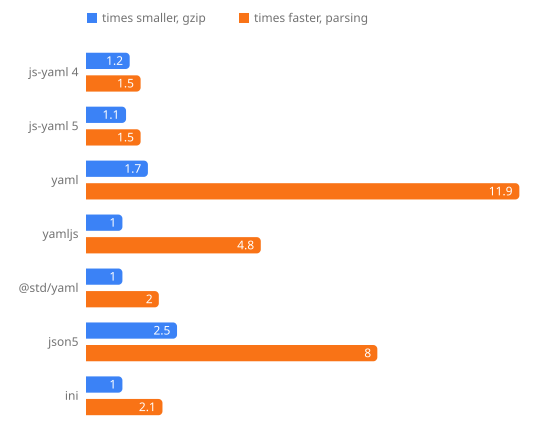

<h1>
  
</h1>

Smaller, faster, dependency-free parsers you can drop in for the libraries you already use. Change one import and keep your code. Each package matches its original on that library's own tests and on hundreds of thousands of fuzzed inputs, and lists every place it still differs.



- **[tinyaml](./packages/tinyaml)** replaces js-yaml 4 and 5, yaml, yamljs and @std/yaml.
- **[tinyjson5](./packages/tinyjson5)** replaces json5 2.2.3.
- **[tinyini](./packages/tinyini)** replaces ini 7.0.0. It's faster, not smaller.

Docs: [tiny.onmax.me](https://tiny.onmax.me)

```sh
pnpm add tinyaml tinyjson5 tinyini
```

Each package is published on its own, so install only the ones you use. Each README says how its numbers were measured.

## Develop

A pnpm workspace with Node 26, pnpm 12, and [Vite+](https://viteplus.dev) (`vp`) for formatting, linting, tests and builds.

```sh
pnpm install
pnpm build    # every package
pnpm check    # format, lint and typecheck every package
pnpm test     # every package's tests
pnpm fixtures # download what the comparisons and benchmarks run against
pnpm charts   # fetch fixtures, measure every package again, redraw .github/assets/drop-ins.svg
pnpm brand    # redraw the logo, favicon and banners from .github/scripts/brand.ts
```

All packages share one version and release together.

## License

MIT, by [@onmax](https://github.com/onmax).
