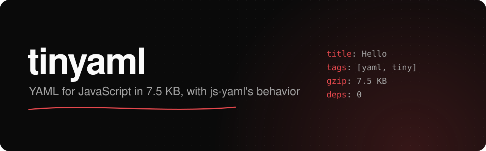

<h1>
  
</h1>

[](https://github.com/onmax/tinyaml/releases)
[](./LICENSE)
[](https://www.npmjs.com/package/tinyaml)
[](https://github.com/onmax/tinyaml/actions/workflows/release.yaml)

tinyaml reads and writes YAML the way js-yaml does with `JSON_SCHEMA`. It is 7.5 KB gzipped where js-yaml is 17.1 KB, has no dependencies, and loads 1.6 to 2.4 times faster. I wrote it for [Comark](https://comark.dev), which reads YAML for frontmatter and component props and was bundling all of js-yaml to do it.

[Get started](#get-started) · [Compatibility](#compatibility-with-js-yaml) · [Size and speed](#size-and-speed) · [npm](https://www.npmjs.com/package/tinyaml)

An independent project by [@onmax](https://github.com/onmax).

## Get started

```sh
pnpm add tinyaml
```

```ts
import { dump, load, loadAll, YAMLException } from "tinyaml";

load("title: Hello\ntags: [a, b]"); // { title: "Hello", tags: ["a", "b"] }
loadAll("a: 1\n---\nb: 2"); // [{ a: 1 }, { b: 2 }]
dump({ title: "Hello", draft: false }); // "title: Hello\ndraft: false\n"
```

`load` returns `undefined` for empty input. It throws a `YAMLException` for invalid YAML or for more than one document, and the message ends with the line and column, as in `duplicated mapping key (2:1)`.

`dump` takes these options:

| Option        | Default | What it does                                                                    |
| ------------- | ------- | ------------------------------------------------------------------------------- |
| `indent`      | `2`     | Spaces per level.                                                               |
| `noRefs`      | `false` | Repeat shared objects instead of writing `&ref_0` anchors and `*ref_0` aliases. |
| `skipInvalid` | `false` | Drop functions, symbols, and other values YAML can't hold instead of throwing.  |
| `sortKeys`    | `false` | Sort mapping keys, by string order or with your compare function.               |
| `lineWidth`   | `-1`    | Only `-1` is supported, so long strings stay on one line.                       |

### Coming from js-yaml

```ts
// js-yaml
import { dump, JSON_SCHEMA, loadAll } from "js-yaml";
loadAll(text, { schema: JSON_SCHEMA });
dump(data, { indent: 2, lineWidth: -1 });

// tinyaml
import { dump, loadAll } from "tinyaml";
loadAll(text);
dump(data);
```

The JSON schema is stricter than js-yaml's default. Only `null`, `true`, `false`, and JSON numbers turn into values. `~`, `yes`, `True`, `0x10`, and `.inf` stay strings, and an empty value is `""`. Tags like `!!str`, `!!int`, `!!float`, `!!bool`, `!!null`, `!!map`, and `!!seq` work. Any other tag throws. Anchors and aliases work, including a node that refers to itself. A `__proto__` key becomes an own property, so YAML can't change an object's prototype.

`dump` writes what js-yaml writes, byte for byte. It quotes strings that YAML 1.1 would read as something else, so `"yes"` comes out as `'yes'`, and it turns shared objects into anchors.

## Compatibility with js-yaml

I tested tinyaml against js-yaml 5.5.0 four ways:

- The [YAML test suite](https://github.com/yaml/yaml-test-suite) gives the same result for all 735 cases, valid and invalid. Both return the same value, or both throw.
- js-yaml's own test suite. Every call it makes to `load`, `loadAll`, and `dump` also runs through tinyaml. All 4,788 load inputs match. Of 359 dump calls, 301 match and the other 58 use options tinyaml doesn't have.
- 240,000 inputs made by editing test-suite files at random. Every one gives the same value or the same failure.
- 5,000 random values dump to the same bytes at indents 2 and 4.

Where tinyaml differs:

- Error text. tinyaml throws on exactly the inputs js-yaml rejects, but the message matches js-yaml in 176 of 418 error cases, and the line and column in 78.
- Schemas and tags. There is no `CORE_SCHEMA`, `YAML11_SCHEMA`, merge keys, `!!binary` loading, or custom tags.
- Loader options. There is no `json`, `onWarning`, `filename`, or `listener`, and nesting is capped at 100 levels as in js-yaml's default.
- Dump options. There is no `flowLevel`, `quoteStyle`, `forceQuotes`, `schema`, or `transform`, and no line folding.
- No AST, event, or presenter APIs.

## Size and speed

Bundled with esbuild, minified ESM, then gzip level 9:

|                                               | Minified | Gzip    |
| --------------------------------------------- | -------- | ------- |
| tinyaml, `loadAll` and `dump`                 | 18.7 KB  | 7.5 KB  |
| tinyaml, `loadAll` only                       | 14.1 KB  | 5.5 KB  |
| js-yaml, `loadAll`, `dump`, and `JSON_SCHEMA` | 56.2 KB  | 17.1 KB |
| js-yaml, `loadAll` and `JSON_SCHEMA` only     | 45.3 KB  | 13.4 KB |

Median time per call on an Apple M4 with Node 26.13. The large file is js-yaml's `package-lock.json` as 176 KB of YAML.

| Operation            | js-yaml | tinyaml | Speedup |
| -------------------- | ------- | ------- | ------- |
| Load frontmatter     | 2.2 µs  | 0.9 µs  | 2.4x    |
| Load component props | 3.3 µs  | 1.5 µs  | 2.1x    |
| Load a 176 KB file   | 2.04 ms | 1.25 ms | 1.6x    |
| Dump frontmatter     | 4.0 µs  | 1.0 µs  | 3.8x    |
| Dump component props | 5.9 µs  | 1.9 µs  | 3.1x    |
| Dump a 176 KB file   | 3.43 ms | 1.52 ms | 2.3x    |

The parser reads character codes in one pass and builds JS values directly, with no tokens or syntax tree in between. The dumper picks each string's style while it writes, where js-yaml builds a tree first.

## Develop

tinyaml uses pnpm 12, Node 26, and [Vite+](https://viteplus.dev) (`vp`) for formatting, linting, tests, and the build. [tsrs](https://github.com/oxc-project/tsrs) does the typecheck.

```sh
pnpm install
pnpm ready                # format, build, lint, typecheck, and test
pnpm suite:fetch          # the YAML test suite, into .cache, so the conformance tests run
pnpm suite                # compare every suite case with js-yaml
pnpm fuzz 40000 3         # 40,000 mutated inputs with seed 3
pnpm js-yaml-tests:fetch  # js-yaml 5.5.0 and its tests, into .cache
pnpm js-yaml-tests        # run js-yaml's suite with every call checked against tinyaml
pnpm size                 # bundle sizes next to js-yaml
pnpm bench                # speed next to js-yaml
```

## License

[MIT](./LICENSE)
