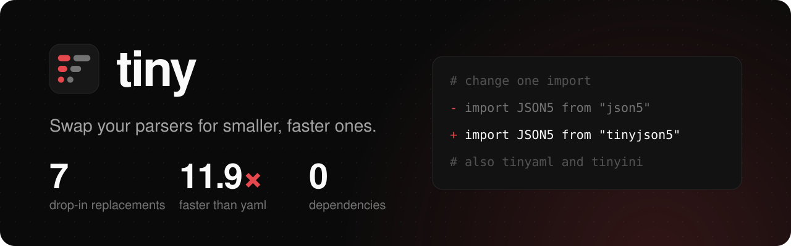

<h1>
  
</h1>

<!-- automd:comark-badges packages=tinyaml,tinyjson5,tinyini -->

[](https://www.npmjs.com/package/tinyaml)
[](https://www.npmjs.com/package/tinyjson5)
[](https://www.npmjs.com/package/tinyini)
[](./LICENSE)
[](https://github.com/onmax/tiny/actions/workflows/release.yaml)

<!-- /automd -->

Smaller, faster, dependency-free parsers you can drop in for the libraries you already use. Change one import and keep your code.

[Packages](#packages) · [Switching](#switching) · [Size and speed](#size-and-speed) · [Docs](https://tiny.onmax.me)

## Packages

| Package | Reads and writes | Replaces |
| --- | --- | --- |
| [tinyaml](./packages/tinyaml) | YAML | js-yaml 4 and 5, yaml, yamljs, @std/yaml |
| [tinyjson5](./packages/tinyjson5) | JSON5 | json5 2.2.3 |
| [tinyini](./packages/tinyini) | INI | ini 7.0.0 |

Each package is published on its own, so install only the ones you use:

```sh
pnpm add tinyaml tinyjson5 tinyini
```

## Switching

Change the import. The calls, options, output and errors stay the same.

```diff
- import yaml from "js-yaml";
+ import yaml from "tinyaml/js-yaml";

- import JSON5 from "json5";
+ import JSON5 from "tinyjson5";

- import ini from "ini";
+ import ini from "tinyini";
```

Each package matches its original on that library's own tests and on tens of thousands to millions of fuzzed inputs, and lists every place it still differs.

## Size and speed

<!-- automd:drop-ins -->

| You use               | Switch to                          |      Size, gzip |       Parses | Stringifies |
| --------------------- | ---------------------------------- | --------------: | -----------: | ----------: |
| js-yaml 4             | `tinyaml/js-yaml`                  | 14.4 → 11.7 KiB |  1.5× faster | 1.6× faster |
| js-yaml 5             | `tinyaml/js-yaml-v5`               | 17.1 → 16.0 KiB |  1.5× faster | 1.8× faster |
| yaml                  | `tinyaml/yaml`                     | 29.9 → 16.8 KiB | 12.6× faster | 2.8× faster |
| yamljs                | `tinyaml/yamljs`                   |   8.8 → 8.0 KiB |  5.0× faster | 1.1× faster |
| @std/yaml             | `tinyaml/std`                      | 11.3 → 10.7 KiB |  2.0× faster | 1.6× faster |
| json5 2.2.3           | `tinyjson5/json5`                  |   7.6 → 3.2 KiB |  7.5× faster | 5.6× faster |
| json5 1.0.2           | `tinyjson5/json5-v1`               |   8.4 → 3.3 KiB |  8.4× faster | 6.4× faster |
| strip-json-comments 3 | `tinyjson5/strip-json-comments`    |   0.8 → 0.5 KiB |  4.1× faster |           — |
| strip-json-comments 2 | `tinyjson5/strip-json-comments-v2` |   0.7 → 0.5 KiB |  4.5× faster |           — |
| strip-json-comments 5 | `tinyjson5/strip-json-comments-v5` |   0.6 → 0.6 KiB |  3.8× faster |           — |
| jsonc-parser 3.3.1    | `tinyjson5/jsonc-parser`           |   6.6 → 5.8 KiB |  1.3× faster |           — |
| comment-json 4.6.2    | `tinyjson5/comment-json`           | 35.7 → 18.4 KiB |  1.5× faster | 1.7× faster |
| jju 1.4.0             | `tinyjson5/jju`                    |   9.8 → 9.7 KiB |  1.2× faster | 1.5× faster |
| ini 7.0.0             | `tinyini`                          |   1.6 → 1.6 KiB |  2.0× faster | 2.9× faster |

Starting fresh with YAML? The root `tinyaml` API is the smallest of all: 7.8 KiB, 1.8× smaller than js-yaml 4 and 3.8× smaller than yaml. It parses 19.3× faster than yaml and stringifies 12.5× faster.

Size is the minified bundle, gzipped. Speed is the median time to parse and stringify each package's large benchmark file. Measured on Apple M4, Node 26.13 (tinyaml, tinyini) and AMD Ryzen 7 255 w/ Radeon 780M Graphics, Node 24.21.0 (tinyjson5).

<!-- /automd -->

tinyini is as small as ini already is, so it only wins on speed. Each package's README has the full results and the inputs they come from.

## Develop

A pnpm workspace with Node 26, pnpm 12, and [Vite+](https://viteplus.dev) (`vp`) for formatting, linting, tests and builds.

```sh
pnpm install
pnpm build    # every package
pnpm check    # format, lint and typecheck every package
pnpm test     # every package's tests
pnpm fixtures # download what the comparisons and benchmarks run against
pnpm drop-ins # fetch fixtures, measure every package again into .github/drop-ins.json, then pnpm readme
pnpm readme   # rewrite the badges and drop-in tables in every README with automd
pnpm brand    # redraw the logo, favicon and banners from .github/scripts/brand.ts
```

All packages share one version and release together.

## License

MIT, by [@onmax](https://github.com/onmax).
