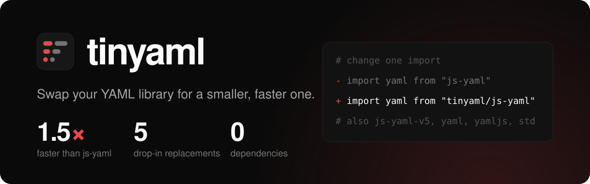
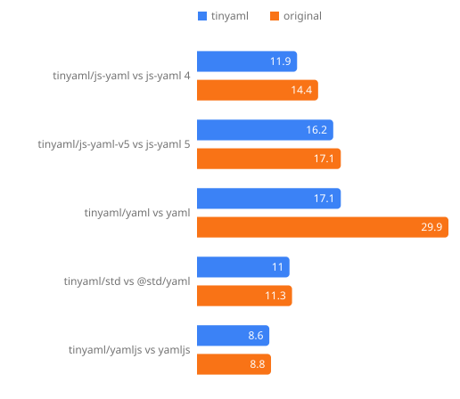
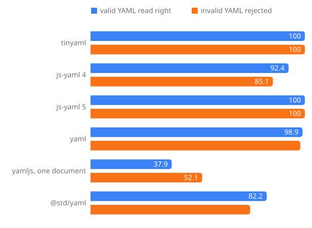
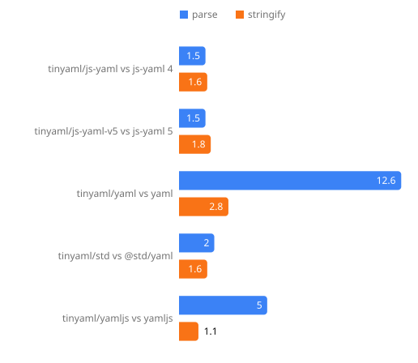

<h1>
  
</h1>

<!-- automd:comark-badges name=tinyaml size=size -->

[](https://github.com/onmax/tiny/releases)
[](#size)
[](https://www.npmjs.com/package/tinyaml?activeTab=dependencies)
[](./LICENSE)
[](https://github.com/onmax/tiny/actions/workflows/release.yaml)

<!-- /automd -->

**YAML for JavaScript in 8.1 KiB.** No dependencies, 12–19× faster than yaml, and right on all 373 [yaml-test-suite](https://github.com/yaml/yaml-test-suite) cases with an expected result: every valid document read, every invalid one rejected. js-yaml, yaml, yamljs and @std/yaml each miss some.

Already on another YAML library? Change one import and keep your code:

```diff
- import yaml from "js-yaml";
+ import yaml from "tinyaml/js-yaml";
```

tinyaml ships drop-in replacements for js-yaml 4 and 5, yaml, yamljs and @std/yaml. Each one is smaller and faster than the library it replaces, on every benchmark we run, and each is checked against that library's own tests and thousands of fuzzed inputs.

<!-- automd:drop-ins package=tinyaml -->

| You use   | Switch to            |      Size, gzip |       Parses | Stringifies |
| --------- | -------------------- | --------------: | -----------: | ----------: |
| js-yaml 4 | `tinyaml/js-yaml`    | 14.4 → 11.8 KiB |  1.5× faster | 1.6× faster |
| js-yaml 5 | `tinyaml/js-yaml-v5` | 17.1 → 15.9 KiB |  1.5× faster | 1.8× faster |
| yaml      | `tinyaml/yaml`       | 29.9 → 16.3 KiB | 12.6× faster | 2.8× faster |
| yamljs    | `tinyaml/yamljs`     |   8.8 → 8.5 KiB |  5.0× faster | 1.1× faster |
| @std/yaml | `tinyaml/std`        | 11.3 → 10.9 KiB |  2.0× faster | 1.6× faster |

Starting fresh with YAML? The root `tinyaml` API is the smallest of all: 8.1 KiB, 1.8× smaller than js-yaml 4 and 3.7× smaller than yaml. It parses 19.3× faster than yaml and stringifies 12.5× faster.

Size is the minified bundle, gzipped. Speed is the median time to parse and stringify the large benchmark file. Measured on Apple M4, Node 26.13.

<!-- /automd -->

[Get started](#get-started) · [Switching](#switching-from-another-library) · [Size](#size) · [Correctness](#correctness) · [Speed](#speed) · [Comparison](#how-it-compares) · [API](#api) · [npm](https://www.npmjs.com/package/tinyaml)

An independent project by [@onmax](https://github.com/onmax).

## Get started

```sh
pnpm add tinyaml
```

npm holds only a 0.0.0 placeholder under this name until the first release. Until then, clone this repository and run `pnpm install` and `pnpm build` to get the package in `dist/`.

```ts
import { parse, parseAll, stringify } from "tinyaml";

parse("title: Hello\ntags: [a, b]\ncount: 0x1F"); // { title: "Hello", tags: ["a", "b"], count: 31 }
parseAll("a: 1\n---\nb: 2"); // [{ a: 1 }, { b: 2 }]
stringify({ title: "Hello", draft: false, answer: "yes" }); // "title: Hello\ndraft: false\nanswer: 'yes'\n"
```

Values follow the YAML 1.2 core schema. `true`, `null`, `~`, `.5`, `0o17`, `0x1F` and `.inf` become values, and `yes`, `on` and dates stay strings.

Merge keys work and are on by default:

```ts
parse("base: &base { a: 1 }\nchild:\n  <<: *base\n  b: 2");
// { base: { a: 1 }, child: { a: 1, b: 2 } }
```

Custom tags are functions that get the node's value, and they can call `parse` themselves. A tag you don't handle keeps its value instead of throwing:

```ts
parse("home: !env HOME", {
  tags: { "!env": (value) => (typeof value === "string" ? process.env[value] : undefined) },
});
parse("x: !thing 12"); // { x: "12" }
```

Errors are `YAMLError`s with a 1-based `line` and `column`, also at the end of the message:

```ts
parse("a: 1\na: 2"); // throws YAMLError: duplicated mapping key (2:1)
```

`stringify` writes what `JSON.stringify` would keep, with a few differences. Functions, symbols and `undefined` are left out of objects. In arrays they become `null`, and so do holes. `toJSON` is called with no key, so a Date becomes an ISO string, and a `toJSON` that returns `undefined` leaves the value out. A BigInt throws. Numbers JSON can't write become YAML ones: `Infinity` is `.inf`, `NaN` is `.nan` and `-0` is `-0.0`. Any other object is written from its own enumerable keys, so a Map or a boxed `new Number(5)` becomes `{}`. It quotes strings a YAML 1.1 reader would take for something else, so `"yes"` comes out as `'yes'` and `"0777"` as `'0777'`.

Collection keys such as `[a, b]: c` throw on purpose. A list can't be a JavaScript object key without being turned into a string.

## Switching from another library

Each subpath exports the functions, options and types of the library it replaces, apart from the gaps listed below, so switching is a change to the import line. The sizes are esbuild bundles of the published files, minified, then gzip -9. The last column is that library's own test suite, run with tinyaml in its place.

| Library         | Change the import to   | Size, gzip      | Its own tests on tinyaml |
| --------------- | ---------------------- | --------------- | ------------------------ |
| js-yaml 4.3.2   | `"tinyaml/js-yaml"`    | 14.4 → 11.8 KiB | 301 of 304 pass          |
| js-yaml 5.5.0   | `"tinyaml/js-yaml-v5"` | 17.1 → 15.9 KiB | 1,023 of 1,646 pass      |
| yaml 2.9.1      | `"tinyaml/yaml"`       | 29.9 → 16.3 KiB | 195 of 220 pass          |
| yamljs 0.3.0    | `"tinyaml/yamljs"`     | 8.8 → 8.5 KiB   | 103 of 103 pass          |
| @std/yaml 1.3.0 | `"tinyaml/std"`        | 11.3 → 10.9 KiB | 92 of 95 pass            |

```ts
// before
import yaml from "js-yaml";
// after
import yaml from "tinyaml/js-yaml";
```

Of js-yaml 5's 1,646 tests, 610 call the events and AST API that tinyaml/js-yaml-v5 leaves out, and js-yaml 5 skips 13 itself. The other 1,023 pass. yaml's five test files that cover `parse` and `stringify` hold 531 tests, and the 220 counted are the ones that call tinyaml. The rest test yaml's Document API.

For yamljs and @std/yaml the swap saves less than 1 KiB. The bigger change is the parser. On the yaml-test-suite, tinyaml/yamljs loads 144 cases that yamljs throws on, and in 39 where the two disagree only tinyaml/yamljs matches the suite.

Every subpath runs the same parser code as the root. The details below list each known difference from the original.

<details>
<summary>js-yaml 4: what's different</summary>

- The `listener` option isn't supported. It accounts for 2 of the 3 tests that don't pass. js-yaml skips the third test itself.
- `safeLoad`, `safeLoadAll` and `safeDump` work and do what `load`, `loadAll` and `dump` do. js-yaml 4 throws for them.
- js-yaml's tests make 746 calls to `load`, `loadAll` and `dump`. Replayed through tinyaml, 739 give the same result, and 7 throw the same error at a different position. tinyaml throws in every case js-yaml does.
- On the yaml-test-suite, 399 of 402 cases give the same result as js-yaml. 1 is valid YAML that tinyaml loads and js-yaml rejects ([9KAX](https://github.com/yaml/yaml-test-suite/tree/data-2022-01-17/9KAX)). The other 2 are js-yaml bugs tinyaml doesn't copy: js-yaml drops a tag on its own line above a less indented block scalar ([M5C3](https://github.com/yaml/yaml-test-suite/tree/data-2022-01-17/M5C3)), and it loads the invalid [H7J7](https://github.com/yaml/yaml-test-suite/tree/data-2022-01-17/H7J7).
- 5,000 randomly edited suite inputs: none load to a different value, none throw only in tinyaml, and 10 load where js-yaml throws, 1 of them invalid YAML. 5,000 random values give matching outcomes, including matching errors: 4,021 dump to the same text and 979 throw the same error.

</details>

<details>
<summary>js-yaml 5: what's different</summary>

- Only the load and dump API: `load`, `loadAll`, `dump`, `YAMLException`, `Schema`, the schemas, the tag definitions and the style constants. The events, AST, presenter and visit API isn't there: `parseEvents`, `getScalarValue`, `constructFromEvents`, `eventsToAst`, `jsToAst`, `present`, `visit`, and the `EVENT_*`, `VISIT_*` and `CHOMPING_*` constants.
- `dump`'s `transform` option works. `dump` builds the same AST as js-yaml 5 and passes it to `transform`, but there is no `visit` to walk it with.
- js-yaml 5's tests make 10,085 calls to `load`, `loadAll` and `dump`, 5,256 of them different in function, input or options. Replayed through tinyaml, 5,213 of those 5,256 give the same result. 20 throw the same error at a different position, and 22 throw with a different message. tinyaml throws in every case js-yaml 5 does.
- The one call that loads to a different value is an empty key tagged `!!merge` with `mergeTag` in the schema, `? !!merge\n: []`. js-yaml 5 loads `{}`, and tinyaml loads `{ "<<": [] }`.
- On the yaml-test-suite, all 402 cases give the same result as js-yaml 5. Both reject 126, and 109 of those throw the same message.
- 5,000 randomly edited suite inputs: none load to a different value, and 2 load where js-yaml 5 throws. 5,000 random values give matching outcomes, including matching errors: 3,584 dump to the same text and 1,416 throw the same error.

</details>

<details>
<summary>yaml: what's different</summary>

- Only `parse` and `stringify`. There is no `parseDocument`, `parseAllDocuments`, Document, CST, Lexer, Parser, Composer, LineCounter or visitor API.
- `parse` doesn't support `mapAsMap`, `stringKeys`, `strict: false` (which `strict: undefined` also means to yaml), or recovering from errors with `logLevel: "silent"`. Collection keys are turned into strings that don't always match yaml's.
- A lone carriage return is a line break, as the YAML spec has it. yaml reads it as text, so `- a\r- b` is `["a", "b"]` where yaml gives `["a\r- b"]`. Error positions count such input as one line, as yaml's do.
- `stringify` doesn't take Document or Node values, writes no comments, and doesn't use `customTags` or the YAML 1.1 `!!set`, `!!omap` and `!!binary` tags.
- A collection tag's `resolve` gets a stand-in for yaml's YAMLMap or YAMLSeq node. It has `items`, with Scalar, Pair and collection nodes in them, `get`, `has`, `toJSON` and `toString`, and nothing else of yaml's node API. An alias in it is a node of the alias's value, `toJSON` returns the collection as tinyaml parsed it, and `nodeClass` isn't used. There, and in `!!set`, keys that are array indices such as `1` come first, as they do in a JS object.
- With `compat`, `stringify` quotes what yaml quotes and `parse` warns where yaml warns about plain scalars, but `parse` doesn't warn about a flow collection whose closing bracket is at its parent's indentation.
- The upstream run covers yaml's tests of `parse` and `stringify`, the `stringify`, `parse`, `errors`, `types` and `anchors` files in `tests/doc/`. Of the 25 that fail, 4 are `logLevel` tests that fail against yaml itself under Vitest, and 13 use the features above. 5 stringify with `indent: 1`, `indent: 4` or `indentSeq: false`, where the output differs. The last 3 are parse cases: a merge key missing its space, which throws another message, carriage returns inside double quotes, and a collection key in an alias expansion test with the limits turned off.
- Across 7 option sets on the yaml-test-suite, 2,584 of 2,814 runs agree with yaml.
- 5,000 randomly edited suite inputs: 1,943 give the same value and the same warnings. 21 more throw the same error with other warnings, since tinyaml stops at the first error and yaml warns about what follows it, unknown aliases included. 2,922 throw in both: 350 the same error, 827 another error code, and the rest the same code at another position or with another message, since tinyaml marks one character where yaml marks the whole token, and words most errors as js-yaml 4 does. 36 load to a different value, 20 of those with a collection key. 48 load only in tinyaml and 30 only in yaml. Lone carriage returns, which yaml reads as text, cause most of these: all 16 other values without a collection key, 39 of the 48 and 22 of the 30. 5,000 random values: 4,932 stringify to the same text, 68 throw the same error, none differ.

</details>

<details>
<summary>yamljs: what's different</summary>

`stringify` writes what yamljs writes, byte for byte. `parse` gives yamljs's values but reads structure as YAML does where yamljs's result is broken:

- Multi-line plain and quoted scalars fold line breaks to spaces, and folded block scalars keep more-indented lines. `a: x\n  y` is `"x y"`, where yamljs gives `"x\ny"`.
- `- - a` is `[["a"]]`, where yamljs gives `["- a"]`. `- ? a` is `[{ a: null }]`, where yamljs gives `["? a"]`.
- Flow mapping keys are read whole: `{a b: 1}` is `{ "a b": 1 }`, where yamljs gives `{ a: "b: 1" }`.
- `\x`, `\u` and `\U` escapes give the character, not its UTF-8 bytes.
- Block scalars keep trailing spaces on their last line.
- Quoted strings stay strings. `['*a']` is `["*a"]` and `!!str "x"` is `"x"`, where yamljs gives `[undefined]` and `'"x"'`.
- An alias in a flow collection gives its anchor's value. After `a: &x 1`, `b: {c: *x}` is `{ c: 1 }` and `b: [*x]` is `[1]`, where yamljs gives the text `"*x"`.
- Keys named like built-in object properties, such as `constructor`, `toString` or `hasOwnProperty`, are kept. yamljs drops them: `constructor: 1` gives `null` and `{constructor: 1}` gives `{}`.
- `<<` merges in flow mappings too. yamljs merges only in block mappings, so `{<<: {a: 1}}` gives `{ "<<": { a: 1 } }` there.
- A comment line is never read as a value or key.
- Errors are `ParseException`s with the root's messages.

On the yaml-test-suite's 402 cases, 186 give the same result as yamljs, and 144 load where yamljs throws. In 39 the values differ and only tinyaml/yamljs matches the suite. In 33 neither matches or the case is invalid YAML. There is no case where only yamljs is right. 5,000 random values give matching outcomes, including matching errors: 4,994 dump to the same text and 6 throw the same error.

</details>

<details>
<summary>@std/yaml: what's different</summary>

- `unstable_parse` and `unstable_stringify` aren't supported. They account for 2 of the 3 tests that don't pass. The third starts a Deno subprocess, which can't run under Node.
- On the yaml-test-suite, 360 of 402 cases give the same result as std, 99 of them the same error message. 11 parse where std throws. The other 31 differ, and in all 31 std's own result is wrong by the suite's answers.
- 5,000 randomly edited suite inputs: 117 parse to a different value, 146 throw only in tinyaml, and 48 parse where std throws, so values or acceptance differ in 311 of them, 6.2%. 2,866 throw in both, 2,541 of them with the same message and 2,570 with the same message apart from the position.
- 5,000 random values give matching outcomes, including matching errors: 3,499 stringify to the same text and 1,501 throw the same error.

</details>

## Size



Each entry as npm ships it in `dist/`, bundled with esbuild, minified ESM, then gzip -9, from [`scripts/size.ts`](./scripts/size.ts). A KiB is 1,024 bytes. Gzip sizes come from the zlib in the official Node builds; a Node linked to another zlib, such as Homebrew's, gives about 1% less.

<details>
<summary>All sizes</summary>

| Entry                | Minified | Gzip     |
| -------------------- | -------- | -------- |
| `tinyaml`            | 17.9 KiB | 8.1 KiB  |
| `tinyaml/js-yaml`    | 26.5 KiB | 11.8 KiB |
| js-yaml 4            | 42.8 KiB | 14.4 KiB |
| `tinyaml/js-yaml-v5` | 38.8 KiB | 15.9 KiB |
| js-yaml 5            | 56.4 KiB | 17.1 KiB |
| `tinyaml/yaml`       | 38.4 KiB | 16.3 KiB |
| yaml                 | 95.8 KiB | 29.9 KiB |
| `tinyaml/yamljs`     | 19.0 KiB | 8.5 KiB  |
| yamljs               | 28.4 KiB | 8.8 KiB  |
| `tinyaml/std`        | 25.0 KiB | 10.9 KiB |
| @std/yaml            | 35.4 KiB | 11.3 KiB |

The tinyaml entries export everything in the subpath. js-yaml 4 and yamljs are bundled whole, js-yaml 5 with `load`, `loadAll`, `dump`, `Schema` and `YAMLException`, yaml with only `parse` and `stringify`, and @std/yaml with `parse`, `parseAll` and `stringify`.

</details>

The parser is one pass over character codes that builds JS values directly, with no tokens or syntax tree in between. Every entry shares it, so a subpath only adds its own value rules, error messages and stringifier. Each entry is built with the branches of one parser mode only: the spec for the root and tinyaml/yaml, js-yaml 4's leniency for tinyaml/js-yaml, tinyaml/yamljs and tinyaml/std, and js-yaml 5's rules for tinyaml/js-yaml-v5. `scripts/size.ts` fails if an entry still holds another mode's code. The parser reports errors as numbered codes, and each entry has its own table of wording, so no bundle carries another library's messages.

## Correctness



[`scripts/correctness.ts`](./scripts/correctness.ts) runs every library on the [yaml-test-suite](https://github.com/yaml/yaml-test-suite/tree/data-2022-01-17) and scores it against the suite's own answers. A valid case has to load to the JSON in its `in.json`, and an invalid case has to throw. The 29 cases without expected JSON are left out. Each library uses its YAML 1.2 core schema where it has one. yaml runs with `schema: "core"` and `resolveKnownTags: false`, and tinyaml with `merge: false`. yamljs has one fixed schema, and @std/yaml's `core` still reads some YAML 1.1 forms. A valid case a library refuses only because it has no type for a custom tag like `!foo` is counted in its own column, since that's a choice and not a misreading. The first column and the chart leave those cases out.

yamljs reads one document, so it's scored on the 256 valid cases with exactly one. Of the 18 valid streams with several documents, it reads the first document right in 3 and throws on 11. On the 5 empty streams it returns `null` for 3.

| Library         | Valid YAML read right | Refused for an unknown tag | Invalid YAML rejected |
| --------------- | --------------------- | -------------------------- | --------------------- |
| tinyaml         | 279 of 279            | 0                          | 94 of 94              |
| js-yaml 4.3.2   | 244 of 264            | 15                         | 80 of 94              |
| js-yaml 5.5.0   | 263 of 263            | 16                         | 94 of 94              |
| yaml 2.9.1      | 276 of 279            | 0                          | 92 of 94              |
| yamljs 0.3.0    | 97 of 256             | 0                          | 49 of 94              |
| @std/yaml 1.3.0 | 217 of 264            | 15                         | 70 of 94              |

tinyaml's root gets every case right, including the 5 that yaml gets wrong and the 34 that js-yaml 4 gets wrong. js-yaml 5 is the only other library with no wrong answers, and it refuses 16 valid cases for their tags. Each list below links the cases a library gets wrong.

<details>
<summary>js-yaml 4: 34 cases wrong</summary>

- Valid YAML read to the wrong value (5): [82AN](https://github.com/yaml/yaml-test-suite/tree/data-2022-01-17/82AN), [8G76](https://github.com/yaml/yaml-test-suite/tree/data-2022-01-17/8G76), [98YD](https://github.com/yaml/yaml-test-suite/tree/data-2022-01-17/98YD), [HWV9](https://github.com/yaml/yaml-test-suite/tree/data-2022-01-17/HWV9), [QT73](https://github.com/yaml/yaml-test-suite/tree/data-2022-01-17/QT73)
- Valid YAML rejected (15): [4MUZ/00](https://github.com/yaml/yaml-test-suite/tree/data-2022-01-17/4MUZ), [4MUZ/01](https://github.com/yaml/yaml-test-suite/tree/data-2022-01-17/4MUZ), [4MUZ/02](https://github.com/yaml/yaml-test-suite/tree/data-2022-01-17/4MUZ), [5MUD](https://github.com/yaml/yaml-test-suite/tree/data-2022-01-17/5MUD), [9KAX](https://github.com/yaml/yaml-test-suite/tree/data-2022-01-17/9KAX), [9SA2](https://github.com/yaml/yaml-test-suite/tree/data-2022-01-17/9SA2), [DK3J](https://github.com/yaml/yaml-test-suite/tree/data-2022-01-17/DK3J), [FP8R](https://github.com/yaml/yaml-test-suite/tree/data-2022-01-17/FP8R), [K3WX](https://github.com/yaml/yaml-test-suite/tree/data-2022-01-17/K3WX), [M7A3](https://github.com/yaml/yaml-test-suite/tree/data-2022-01-17/M7A3), [NJ66](https://github.com/yaml/yaml-test-suite/tree/data-2022-01-17/NJ66), [UT92](https://github.com/yaml/yaml-test-suite/tree/data-2022-01-17/UT92), [VJP3/01](https://github.com/yaml/yaml-test-suite/tree/data-2022-01-17/VJP3), [W4TN](https://github.com/yaml/yaml-test-suite/tree/data-2022-01-17/W4TN), [WZ62](https://github.com/yaml/yaml-test-suite/tree/data-2022-01-17/WZ62)
- Invalid YAML accepted (14): [3HFZ](https://github.com/yaml/yaml-test-suite/tree/data-2022-01-17/3HFZ), [4JVG](https://github.com/yaml/yaml-test-suite/tree/data-2022-01-17/4JVG), [9C9N](https://github.com/yaml/yaml-test-suite/tree/data-2022-01-17/9C9N), [9JBA](https://github.com/yaml/yaml-test-suite/tree/data-2022-01-17/9JBA), [9KBC](https://github.com/yaml/yaml-test-suite/tree/data-2022-01-17/9KBC), [CVW2](https://github.com/yaml/yaml-test-suite/tree/data-2022-01-17/CVW2), [CXX2](https://github.com/yaml/yaml-test-suite/tree/data-2022-01-17/CXX2), [DK95/01](https://github.com/yaml/yaml-test-suite/tree/data-2022-01-17/DK95), [H7J7](https://github.com/yaml/yaml-test-suite/tree/data-2022-01-17/H7J7), [QB6E](https://github.com/yaml/yaml-test-suite/tree/data-2022-01-17/QB6E), [S98Z](https://github.com/yaml/yaml-test-suite/tree/data-2022-01-17/S98Z), [SU5Z](https://github.com/yaml/yaml-test-suite/tree/data-2022-01-17/SU5Z), [Y79Y/000](https://github.com/yaml/yaml-test-suite/tree/data-2022-01-17/Y79Y), [Y79Y/003](https://github.com/yaml/yaml-test-suite/tree/data-2022-01-17/Y79Y)

</details>

<details>
<summary>yaml: 5 cases wrong</summary>

- Valid YAML read to the wrong value (3): [HWV9](https://github.com/yaml/yaml-test-suite/tree/data-2022-01-17/HWV9), [M7A3](https://github.com/yaml/yaml-test-suite/tree/data-2022-01-17/M7A3), [QT73](https://github.com/yaml/yaml-test-suite/tree/data-2022-01-17/QT73)
- Invalid YAML accepted (2): [9MMA](https://github.com/yaml/yaml-test-suite/tree/data-2022-01-17/9MMA), [SF5V](https://github.com/yaml/yaml-test-suite/tree/data-2022-01-17/SF5V)

</details>

<details>
<summary>yamljs: 204 cases wrong</summary>

- Valid YAML read to the wrong value (51): [26DV](https://github.com/yaml/yaml-test-suite/tree/data-2022-01-17/26DV), [27NA](https://github.com/yaml/yaml-test-suite/tree/data-2022-01-17/27NA), [2G84/02](https://github.com/yaml/yaml-test-suite/tree/data-2022-01-17/2G84), [2G84/03](https://github.com/yaml/yaml-test-suite/tree/data-2022-01-17/2G84), [2SXE](https://github.com/yaml/yaml-test-suite/tree/data-2022-01-17/2SXE), [36F6](https://github.com/yaml/yaml-test-suite/tree/data-2022-01-17/36F6), [3ALJ](https://github.com/yaml/yaml-test-suite/tree/data-2022-01-17/3ALJ), [4ZYM](https://github.com/yaml/yaml-test-suite/tree/data-2022-01-17/4ZYM), [52DL](https://github.com/yaml/yaml-test-suite/tree/data-2022-01-17/52DL), [565N](https://github.com/yaml/yaml-test-suite/tree/data-2022-01-17/565N), [58MP](https://github.com/yaml/yaml-test-suite/tree/data-2022-01-17/58MP), [5T43](https://github.com/yaml/yaml-test-suite/tree/data-2022-01-17/5T43), [6BCT](https://github.com/yaml/yaml-test-suite/tree/data-2022-01-17/6BCT), [6CA3](https://github.com/yaml/yaml-test-suite/tree/data-2022-01-17/6CA3), [6JWB](https://github.com/yaml/yaml-test-suite/tree/data-2022-01-17/6JWB), [735Y](https://github.com/yaml/yaml-test-suite/tree/data-2022-01-17/735Y), [7BMT](https://github.com/yaml/yaml-test-suite/tree/data-2022-01-17/7BMT), [7FWL](https://github.com/yaml/yaml-test-suite/tree/data-2022-01-17/7FWL), [7ZZ5](https://github.com/yaml/yaml-test-suite/tree/data-2022-01-17/7ZZ5), [82AN](https://github.com/yaml/yaml-test-suite/tree/data-2022-01-17/82AN), [8MK2](https://github.com/yaml/yaml-test-suite/tree/data-2022-01-17/8MK2), [9SA2](https://github.com/yaml/yaml-test-suite/tree/data-2022-01-17/9SA2), [AB8U](https://github.com/yaml/yaml-test-suite/tree/data-2022-01-17/AB8U), [DC7X](https://github.com/yaml/yaml-test-suite/tree/data-2022-01-17/DC7X), [DK95/02](https://github.com/yaml/yaml-test-suite/tree/data-2022-01-17/DK95), [DK95/08](https://github.com/yaml/yaml-test-suite/tree/data-2022-01-17/DK95), [EXG3](https://github.com/yaml/yaml-test-suite/tree/data-2022-01-17/EXG3), [F2C7](https://github.com/yaml/yaml-test-suite/tree/data-2022-01-17/F2C7), [FBC9](https://github.com/yaml/yaml-test-suite/tree/data-2022-01-17/FBC9), [G4RS](https://github.com/yaml/yaml-test-suite/tree/data-2022-01-17/G4RS), [JEF9/02](https://github.com/yaml/yaml-test-suite/tree/data-2022-01-17/JEF9), [K54U](https://github.com/yaml/yaml-test-suite/tree/data-2022-01-17/K54U), [K858](https://github.com/yaml/yaml-test-suite/tree/data-2022-01-17/K858), [L24T/00](https://github.com/yaml/yaml-test-suite/tree/data-2022-01-17/L24T), [L24T/01](https://github.com/yaml/yaml-test-suite/tree/data-2022-01-17/L24T), [L9U5](https://github.com/yaml/yaml-test-suite/tree/data-2022-01-17/L9U5), [LE5A](https://github.com/yaml/yaml-test-suite/tree/data-2022-01-17/LE5A), [MUS6/02](https://github.com/yaml/yaml-test-suite/tree/data-2022-01-17/MUS6), [MUS6/03](https://github.com/yaml/yaml-test-suite/tree/data-2022-01-17/MUS6), [MUS6/05](https://github.com/yaml/yaml-test-suite/tree/data-2022-01-17/MUS6), [MUS6/06](https://github.com/yaml/yaml-test-suite/tree/data-2022-01-17/MUS6), [NAT4](https://github.com/yaml/yaml-test-suite/tree/data-2022-01-17/NAT4), [R4YG](https://github.com/yaml/yaml-test-suite/tree/data-2022-01-17/R4YG), [S4JQ](https://github.com/yaml/yaml-test-suite/tree/data-2022-01-17/S4JQ), [UV7Q](https://github.com/yaml/yaml-test-suite/tree/data-2022-01-17/UV7Q), [W42U](https://github.com/yaml/yaml-test-suite/tree/data-2022-01-17/W42U), [WZ62](https://github.com/yaml/yaml-test-suite/tree/data-2022-01-17/WZ62), [XLQ9](https://github.com/yaml/yaml-test-suite/tree/data-2022-01-17/XLQ9), [Y79Y/001](https://github.com/yaml/yaml-test-suite/tree/data-2022-01-17/Y79Y), [Z67P](https://github.com/yaml/yaml-test-suite/tree/data-2022-01-17/Z67P), [ZH7C](https://github.com/yaml/yaml-test-suite/tree/data-2022-01-17/ZH7C)
- Valid YAML rejected (108): [2LFX](https://github.com/yaml/yaml-test-suite/tree/data-2022-01-17/2LFX), [2XXW](https://github.com/yaml/yaml-test-suite/tree/data-2022-01-17/2XXW), [3MYT](https://github.com/yaml/yaml-test-suite/tree/data-2022-01-17/3MYT), [3R3P](https://github.com/yaml/yaml-test-suite/tree/data-2022-01-17/3R3P), [3RLN/00](https://github.com/yaml/yaml-test-suite/tree/data-2022-01-17/3RLN), [3RLN/01](https://github.com/yaml/yaml-test-suite/tree/data-2022-01-17/3RLN), [3RLN/02](https://github.com/yaml/yaml-test-suite/tree/data-2022-01-17/3RLN), [3RLN/03](https://github.com/yaml/yaml-test-suite/tree/data-2022-01-17/3RLN), [3RLN/04](https://github.com/yaml/yaml-test-suite/tree/data-2022-01-17/3RLN), [3RLN/05](https://github.com/yaml/yaml-test-suite/tree/data-2022-01-17/3RLN), [4CQQ](https://github.com/yaml/yaml-test-suite/tree/data-2022-01-17/4CQQ), [4Q9F](https://github.com/yaml/yaml-test-suite/tree/data-2022-01-17/4Q9F), [57H4](https://github.com/yaml/yaml-test-suite/tree/data-2022-01-17/57H4), [5GBF](https://github.com/yaml/yaml-test-suite/tree/data-2022-01-17/5GBF), [5MUD](https://github.com/yaml/yaml-test-suite/tree/data-2022-01-17/5MUD), [5WE3](https://github.com/yaml/yaml-test-suite/tree/data-2022-01-17/5WE3), [652Z](https://github.com/yaml/yaml-test-suite/tree/data-2022-01-17/652Z), [6CK3](https://github.com/yaml/yaml-test-suite/tree/data-2022-01-17/6CK3), [6FWR](https://github.com/yaml/yaml-test-suite/tree/data-2022-01-17/6FWR), [6HB6](https://github.com/yaml/yaml-test-suite/tree/data-2022-01-17/6HB6), [6JQW](https://github.com/yaml/yaml-test-suite/tree/data-2022-01-17/6JQW), [6LVF](https://github.com/yaml/yaml-test-suite/tree/data-2022-01-17/6LVF), [6VJK](https://github.com/yaml/yaml-test-suite/tree/data-2022-01-17/6VJK), [6WPF](https://github.com/yaml/yaml-test-suite/tree/data-2022-01-17/6WPF), [753E](https://github.com/yaml/yaml-test-suite/tree/data-2022-01-17/753E), [7A4E](https://github.com/yaml/yaml-test-suite/tree/data-2022-01-17/7A4E), [7T8X](https://github.com/yaml/yaml-test-suite/tree/data-2022-01-17/7T8X), [7TMG](https://github.com/yaml/yaml-test-suite/tree/data-2022-01-17/7TMG), [7W2P](https://github.com/yaml/yaml-test-suite/tree/data-2022-01-17/7W2P), [87E4](https://github.com/yaml/yaml-test-suite/tree/data-2022-01-17/87E4), [8KB6](https://github.com/yaml/yaml-test-suite/tree/data-2022-01-17/8KB6), [8UDB](https://github.com/yaml/yaml-test-suite/tree/data-2022-01-17/8UDB), [93WF](https://github.com/yaml/yaml-test-suite/tree/data-2022-01-17/93WF), [96L6](https://github.com/yaml/yaml-test-suite/tree/data-2022-01-17/96L6), [9BXH](https://github.com/yaml/yaml-test-suite/tree/data-2022-01-17/9BXH), [9MQT/00](https://github.com/yaml/yaml-test-suite/tree/data-2022-01-17/9MQT), [9TFX](https://github.com/yaml/yaml-test-suite/tree/data-2022-01-17/9TFX), [9YRD](https://github.com/yaml/yaml-test-suite/tree/data-2022-01-17/9YRD), [A2M4](https://github.com/yaml/yaml-test-suite/tree/data-2022-01-17/A2M4), [A984](https://github.com/yaml/yaml-test-suite/tree/data-2022-01-17/A984), [B3HG](https://github.com/yaml/yaml-test-suite/tree/data-2022-01-17/B3HG), [BEC7](https://github.com/yaml/yaml-test-suite/tree/data-2022-01-17/BEC7), [BU8L](https://github.com/yaml/yaml-test-suite/tree/data-2022-01-17/BU8L), [C2DT](https://github.com/yaml/yaml-test-suite/tree/data-2022-01-17/C2DT), [C4HZ](https://github.com/yaml/yaml-test-suite/tree/data-2022-01-17/C4HZ), [CC74](https://github.com/yaml/yaml-test-suite/tree/data-2022-01-17/CC74), [CN3R](https://github.com/yaml/yaml-test-suite/tree/data-2022-01-17/CN3R), [CT4Q](https://github.com/yaml/yaml-test-suite/tree/data-2022-01-17/CT4Q), [CUP7](https://github.com/yaml/yaml-test-suite/tree/data-2022-01-17/CUP7), [DE56/00](https://github.com/yaml/yaml-test-suite/tree/data-2022-01-17/DE56), [DE56/01](https://github.com/yaml/yaml-test-suite/tree/data-2022-01-17/DE56), [DE56/02](https://github.com/yaml/yaml-test-suite/tree/data-2022-01-17/DE56), [DE56/03](https://github.com/yaml/yaml-test-suite/tree/data-2022-01-17/DE56), [DE56/04](https://github.com/yaml/yaml-test-suite/tree/data-2022-01-17/DE56), [DE56/05](https://github.com/yaml/yaml-test-suite/tree/data-2022-01-17/DE56), [DK3J](https://github.com/yaml/yaml-test-suite/tree/data-2022-01-17/DK3J), [DK95/03](https://github.com/yaml/yaml-test-suite/tree/data-2022-01-17/DK95), [DK95/04](https://github.com/yaml/yaml-test-suite/tree/data-2022-01-17/DK95), [DWX9](https://github.com/yaml/yaml-test-suite/tree/data-2022-01-17/DWX9), [E76Z](https://github.com/yaml/yaml-test-suite/tree/data-2022-01-17/E76Z), [EHF6](https://github.com/yaml/yaml-test-suite/tree/data-2022-01-17/EHF6), [EX5H](https://github.com/yaml/yaml-test-suite/tree/data-2022-01-17/EX5H), [FP8R](https://github.com/yaml/yaml-test-suite/tree/data-2022-01-17/FP8R), [G992](https://github.com/yaml/yaml-test-suite/tree/data-2022-01-17/G992), [GH63](https://github.com/yaml/yaml-test-suite/tree/data-2022-01-17/GH63), [HMQ5](https://github.com/yaml/yaml-test-suite/tree/data-2022-01-17/HMQ5), [HS5T](https://github.com/yaml/yaml-test-suite/tree/data-2022-01-17/HS5T), [JTV5](https://github.com/yaml/yaml-test-suite/tree/data-2022-01-17/JTV5), [K3WX](https://github.com/yaml/yaml-test-suite/tree/data-2022-01-17/K3WX), [K527](https://github.com/yaml/yaml-test-suite/tree/data-2022-01-17/K527), [L94M](https://github.com/yaml/yaml-test-suite/tree/data-2022-01-17/L94M), [LP6E](https://github.com/yaml/yaml-test-suite/tree/data-2022-01-17/LP6E), [LQZ7](https://github.com/yaml/yaml-test-suite/tree/data-2022-01-17/LQZ7), [M29M](https://github.com/yaml/yaml-test-suite/tree/data-2022-01-17/M29M), [M5C3](https://github.com/yaml/yaml-test-suite/tree/data-2022-01-17/M5C3), [M7NX](https://github.com/yaml/yaml-test-suite/tree/data-2022-01-17/M7NX), [M9B4](https://github.com/yaml/yaml-test-suite/tree/data-2022-01-17/M9B4), [MJS9](https://github.com/yaml/yaml-test-suite/tree/data-2022-01-17/MJS9), [MYW6](https://github.com/yaml/yaml-test-suite/tree/data-2022-01-17/MYW6), [NB6Z](https://github.com/yaml/yaml-test-suite/tree/data-2022-01-17/NB6Z), [NJ66](https://github.com/yaml/yaml-test-suite/tree/data-2022-01-17/NJ66), [NP9H](https://github.com/yaml/yaml-test-suite/tree/data-2022-01-17/NP9H), [P76L](https://github.com/yaml/yaml-test-suite/tree/data-2022-01-17/P76L), [P94K](https://github.com/yaml/yaml-test-suite/tree/data-2022-01-17/P94K), [PRH3](https://github.com/yaml/yaml-test-suite/tree/data-2022-01-17/PRH3), [Q8AD](https://github.com/yaml/yaml-test-suite/tree/data-2022-01-17/Q8AD), [QF4Y](https://github.com/yaml/yaml-test-suite/tree/data-2022-01-17/QF4Y), [RR7F](https://github.com/yaml/yaml-test-suite/tree/data-2022-01-17/RR7F), [RTP8](https://github.com/yaml/yaml-test-suite/tree/data-2022-01-17/RTP8), [S4T7](https://github.com/yaml/yaml-test-suite/tree/data-2022-01-17/S4T7), [S9E8](https://github.com/yaml/yaml-test-suite/tree/data-2022-01-17/S9E8), [SKE5](https://github.com/yaml/yaml-test-suite/tree/data-2022-01-17/SKE5), [T26H](https://github.com/yaml/yaml-test-suite/tree/data-2022-01-17/T26H), [T4YY](https://github.com/yaml/yaml-test-suite/tree/data-2022-01-17/T4YY), [T5N4](https://github.com/yaml/yaml-test-suite/tree/data-2022-01-17/T5N4), [TL85](https://github.com/yaml/yaml-test-suite/tree/data-2022-01-17/TL85), [TS54](https://github.com/yaml/yaml-test-suite/tree/data-2022-01-17/TS54), [U3C3](https://github.com/yaml/yaml-test-suite/tree/data-2022-01-17/U3C3), [U3XV](https://github.com/yaml/yaml-test-suite/tree/data-2022-01-17/U3XV), [UGM3](https://github.com/yaml/yaml-test-suite/tree/data-2022-01-17/UGM3), [VJP3/01](https://github.com/yaml/yaml-test-suite/tree/data-2022-01-17/VJP3), [X8DW](https://github.com/yaml/yaml-test-suite/tree/data-2022-01-17/X8DW), [XV9V](https://github.com/yaml/yaml-test-suite/tree/data-2022-01-17/XV9V), [Y79Y/002](https://github.com/yaml/yaml-test-suite/tree/data-2022-01-17/Y79Y), [Z9M4](https://github.com/yaml/yaml-test-suite/tree/data-2022-01-17/Z9M4), [ZF4X](https://github.com/yaml/yaml-test-suite/tree/data-2022-01-17/ZF4X), [ZK9H](https://github.com/yaml/yaml-test-suite/tree/data-2022-01-17/ZK9H), [ZWK4](https://github.com/yaml/yaml-test-suite/tree/data-2022-01-17/ZWK4)
- Invalid YAML accepted (45): [2G84/00](https://github.com/yaml/yaml-test-suite/tree/data-2022-01-17/2G84), [2G84/01](https://github.com/yaml/yaml-test-suite/tree/data-2022-01-17/2G84), [4JVG](https://github.com/yaml/yaml-test-suite/tree/data-2022-01-17/4JVG), [55WF](https://github.com/yaml/yaml-test-suite/tree/data-2022-01-17/55WF), [5LLU](https://github.com/yaml/yaml-test-suite/tree/data-2022-01-17/5LLU), [5U3A](https://github.com/yaml/yaml-test-suite/tree/data-2022-01-17/5U3A), [8XDJ](https://github.com/yaml/yaml-test-suite/tree/data-2022-01-17/8XDJ), [9C9N](https://github.com/yaml/yaml-test-suite/tree/data-2022-01-17/9C9N), [9JBA](https://github.com/yaml/yaml-test-suite/tree/data-2022-01-17/9JBA), [9KBC](https://github.com/yaml/yaml-test-suite/tree/data-2022-01-17/9KBC), [9MAG](https://github.com/yaml/yaml-test-suite/tree/data-2022-01-17/9MAG), [9MMA](https://github.com/yaml/yaml-test-suite/tree/data-2022-01-17/9MMA), [B63P](https://github.com/yaml/yaml-test-suite/tree/data-2022-01-17/B63P), [BF9H](https://github.com/yaml/yaml-test-suite/tree/data-2022-01-17/BF9H), [CTN5](https://github.com/yaml/yaml-test-suite/tree/data-2022-01-17/CTN5), [CXX2](https://github.com/yaml/yaml-test-suite/tree/data-2022-01-17/CXX2), [DK95/01](https://github.com/yaml/yaml-test-suite/tree/data-2022-01-17/DK95), [EW3V](https://github.com/yaml/yaml-test-suite/tree/data-2022-01-17/EW3V), [G5U8](https://github.com/yaml/yaml-test-suite/tree/data-2022-01-17/G5U8), [H7TQ](https://github.com/yaml/yaml-test-suite/tree/data-2022-01-17/H7TQ), [HRE5](https://github.com/yaml/yaml-test-suite/tree/data-2022-01-17/HRE5), [LHL4](https://github.com/yaml/yaml-test-suite/tree/data-2022-01-17/LHL4), [MUS6/00](https://github.com/yaml/yaml-test-suite/tree/data-2022-01-17/MUS6), [MUS6/01](https://github.com/yaml/yaml-test-suite/tree/data-2022-01-17/MUS6), [QB6E](https://github.com/yaml/yaml-test-suite/tree/data-2022-01-17/QB6E), [QLJ7](https://github.com/yaml/yaml-test-suite/tree/data-2022-01-17/QLJ7), [RHX7](https://github.com/yaml/yaml-test-suite/tree/data-2022-01-17/RHX7), [S4GJ](https://github.com/yaml/yaml-test-suite/tree/data-2022-01-17/S4GJ), [S98Z](https://github.com/yaml/yaml-test-suite/tree/data-2022-01-17/S98Z), [SF5V](https://github.com/yaml/yaml-test-suite/tree/data-2022-01-17/SF5V), [SR86](https://github.com/yaml/yaml-test-suite/tree/data-2022-01-17/SR86), [SU5Z](https://github.com/yaml/yaml-test-suite/tree/data-2022-01-17/SU5Z), [SU74](https://github.com/yaml/yaml-test-suite/tree/data-2022-01-17/SU74), [SY6V](https://github.com/yaml/yaml-test-suite/tree/data-2022-01-17/SY6V), [U99R](https://github.com/yaml/yaml-test-suite/tree/data-2022-01-17/U99R), [W9L4](https://github.com/yaml/yaml-test-suite/tree/data-2022-01-17/W9L4), [X4QW](https://github.com/yaml/yaml-test-suite/tree/data-2022-01-17/X4QW), [Y79Y/004](https://github.com/yaml/yaml-test-suite/tree/data-2022-01-17/Y79Y), [Y79Y/005](https://github.com/yaml/yaml-test-suite/tree/data-2022-01-17/Y79Y), [Y79Y/006](https://github.com/yaml/yaml-test-suite/tree/data-2022-01-17/Y79Y), [Y79Y/008](https://github.com/yaml/yaml-test-suite/tree/data-2022-01-17/Y79Y), [Y79Y/009](https://github.com/yaml/yaml-test-suite/tree/data-2022-01-17/Y79Y), [YJV2](https://github.com/yaml/yaml-test-suite/tree/data-2022-01-17/YJV2), [ZCZ6](https://github.com/yaml/yaml-test-suite/tree/data-2022-01-17/ZCZ6), [ZVH3](https://github.com/yaml/yaml-test-suite/tree/data-2022-01-17/ZVH3)

</details>

<details>
<summary>@std/yaml: 71 cases wrong</summary>

- Valid YAML read to the wrong value (23): [6KGN](https://github.com/yaml/yaml-test-suite/tree/data-2022-01-17/6KGN), [6WPF](https://github.com/yaml/yaml-test-suite/tree/data-2022-01-17/6WPF), [7A4E](https://github.com/yaml/yaml-test-suite/tree/data-2022-01-17/7A4E), [82AN](https://github.com/yaml/yaml-test-suite/tree/data-2022-01-17/82AN), [8G76](https://github.com/yaml/yaml-test-suite/tree/data-2022-01-17/8G76), [98YD](https://github.com/yaml/yaml-test-suite/tree/data-2022-01-17/98YD), [9TFX](https://github.com/yaml/yaml-test-suite/tree/data-2022-01-17/9TFX), [DE56/01](https://github.com/yaml/yaml-test-suite/tree/data-2022-01-17/DE56), [DE56/03](https://github.com/yaml/yaml-test-suite/tree/data-2022-01-17/DE56), [DE56/04](https://github.com/yaml/yaml-test-suite/tree/data-2022-01-17/DE56), [DE56/05](https://github.com/yaml/yaml-test-suite/tree/data-2022-01-17/DE56), [DK3J](https://github.com/yaml/yaml-test-suite/tree/data-2022-01-17/DK3J), [FP8R](https://github.com/yaml/yaml-test-suite/tree/data-2022-01-17/FP8R), [HWV9](https://github.com/yaml/yaml-test-suite/tree/data-2022-01-17/HWV9), [M7A3](https://github.com/yaml/yaml-test-suite/tree/data-2022-01-17/M7A3), [NAT4](https://github.com/yaml/yaml-test-suite/tree/data-2022-01-17/NAT4), [NP9H](https://github.com/yaml/yaml-test-suite/tree/data-2022-01-17/NP9H), [PRH3](https://github.com/yaml/yaml-test-suite/tree/data-2022-01-17/PRH3), [Q8AD](https://github.com/yaml/yaml-test-suite/tree/data-2022-01-17/Q8AD), [QT73](https://github.com/yaml/yaml-test-suite/tree/data-2022-01-17/QT73), [T4YY](https://github.com/yaml/yaml-test-suite/tree/data-2022-01-17/T4YY), [TL85](https://github.com/yaml/yaml-test-suite/tree/data-2022-01-17/TL85), [W4TN](https://github.com/yaml/yaml-test-suite/tree/data-2022-01-17/W4TN)
- Valid YAML rejected (24): [26DV](https://github.com/yaml/yaml-test-suite/tree/data-2022-01-17/26DV), [2AUY](https://github.com/yaml/yaml-test-suite/tree/data-2022-01-17/2AUY), [2SXE](https://github.com/yaml/yaml-test-suite/tree/data-2022-01-17/2SXE), [33X3](https://github.com/yaml/yaml-test-suite/tree/data-2022-01-17/33X3), [4MUZ/00](https://github.com/yaml/yaml-test-suite/tree/data-2022-01-17/4MUZ), [4MUZ/01](https://github.com/yaml/yaml-test-suite/tree/data-2022-01-17/4MUZ), [4MUZ/02](https://github.com/yaml/yaml-test-suite/tree/data-2022-01-17/4MUZ), [5MUD](https://github.com/yaml/yaml-test-suite/tree/data-2022-01-17/5MUD), [74H7](https://github.com/yaml/yaml-test-suite/tree/data-2022-01-17/74H7), [7BMT](https://github.com/yaml/yaml-test-suite/tree/data-2022-01-17/7BMT), [7FWL](https://github.com/yaml/yaml-test-suite/tree/data-2022-01-17/7FWL), [9KAX](https://github.com/yaml/yaml-test-suite/tree/data-2022-01-17/9KAX), [9SA2](https://github.com/yaml/yaml-test-suite/tree/data-2022-01-17/9SA2), [E76Z](https://github.com/yaml/yaml-test-suite/tree/data-2022-01-17/E76Z), [F2C7](https://github.com/yaml/yaml-test-suite/tree/data-2022-01-17/F2C7), [HMQ5](https://github.com/yaml/yaml-test-suite/tree/data-2022-01-17/HMQ5), [K3WX](https://github.com/yaml/yaml-test-suite/tree/data-2022-01-17/K3WX), [L94M](https://github.com/yaml/yaml-test-suite/tree/data-2022-01-17/L94M), [NJ66](https://github.com/yaml/yaml-test-suite/tree/data-2022-01-17/NJ66), [U3XV](https://github.com/yaml/yaml-test-suite/tree/data-2022-01-17/U3XV), [UT92](https://github.com/yaml/yaml-test-suite/tree/data-2022-01-17/UT92), [VJP3/01](https://github.com/yaml/yaml-test-suite/tree/data-2022-01-17/VJP3), [WZ62](https://github.com/yaml/yaml-test-suite/tree/data-2022-01-17/WZ62), [ZH7C](https://github.com/yaml/yaml-test-suite/tree/data-2022-01-17/ZH7C)
- Invalid YAML accepted (24): [3HFZ](https://github.com/yaml/yaml-test-suite/tree/data-2022-01-17/3HFZ), [4EJS](https://github.com/yaml/yaml-test-suite/tree/data-2022-01-17/4EJS), [62EZ](https://github.com/yaml/yaml-test-suite/tree/data-2022-01-17/62EZ), [9C9N](https://github.com/yaml/yaml-test-suite/tree/data-2022-01-17/9C9N), [9JBA](https://github.com/yaml/yaml-test-suite/tree/data-2022-01-17/9JBA), [9KBC](https://github.com/yaml/yaml-test-suite/tree/data-2022-01-17/9KBC), [9MAG](https://github.com/yaml/yaml-test-suite/tree/data-2022-01-17/9MAG), [CTN5](https://github.com/yaml/yaml-test-suite/tree/data-2022-01-17/CTN5), [CVW2](https://github.com/yaml/yaml-test-suite/tree/data-2022-01-17/CVW2), [DK95/01](https://github.com/yaml/yaml-test-suite/tree/data-2022-01-17/DK95), [DK95/06](https://github.com/yaml/yaml-test-suite/tree/data-2022-01-17/DK95), [H7J7](https://github.com/yaml/yaml-test-suite/tree/data-2022-01-17/H7J7), [JY7Z](https://github.com/yaml/yaml-test-suite/tree/data-2022-01-17/JY7Z), [QB6E](https://github.com/yaml/yaml-test-suite/tree/data-2022-01-17/QB6E), [S98Z](https://github.com/yaml/yaml-test-suite/tree/data-2022-01-17/S98Z), [SU5Z](https://github.com/yaml/yaml-test-suite/tree/data-2022-01-17/SU5Z), [Y79Y/000](https://github.com/yaml/yaml-test-suite/tree/data-2022-01-17/Y79Y), [Y79Y/003](https://github.com/yaml/yaml-test-suite/tree/data-2022-01-17/Y79Y), [Y79Y/004](https://github.com/yaml/yaml-test-suite/tree/data-2022-01-17/Y79Y), [Y79Y/005](https://github.com/yaml/yaml-test-suite/tree/data-2022-01-17/Y79Y), [Y79Y/006](https://github.com/yaml/yaml-test-suite/tree/data-2022-01-17/Y79Y), [Y79Y/007](https://github.com/yaml/yaml-test-suite/tree/data-2022-01-17/Y79Y), [Y79Y/008](https://github.com/yaml/yaml-test-suite/tree/data-2022-01-17/Y79Y), [Y79Y/009](https://github.com/yaml/yaml-test-suite/tree/data-2022-01-17/Y79Y)

</details>

## Speed



Median time per call over 7 rounds, from [`bench/index.ts`](./bench/index.ts), on an Apple M4 with Node 26.13. Each library and the tinyaml entry that replaces it run with default options. The inputs are a 7-line frontmatter block and js-yaml's `package-lock.json` written as YAML, 268 KiB. The last four rows compare tinyaml's root API with yaml, the library closest to its rules.

<details>
<summary>All timings</summary>

| Library    | Operation             |  Library | tinyaml | Speedup |
| ---------- | --------------------- | -------: | ------: | ------: |
| js-yaml 4  | parse frontmatter     |   2.7 µs |  1.7 µs |    1.6x |
| js-yaml 4  | stringify frontmatter |   3.7 µs |  2.5 µs |    1.5x |
| js-yaml 4  | parse 268 KiB         |  3.00 ms | 2.00 ms |    1.5x |
| js-yaml 4  | stringify 268 KiB     |  4.51 ms | 2.77 ms |    1.6x |
| js-yaml 5  | parse frontmatter     |   3.1 µs |  1.7 µs |    1.8x |
| js-yaml 5  | stringify frontmatter |   5.3 µs |  2.7 µs |    2.0x |
| js-yaml 5  | parse 268 KiB         |  3.07 ms | 2.00 ms |    1.5x |
| js-yaml 5  | stringify 268 KiB     |  5.22 ms | 2.90 ms |    1.8x |
| yaml       | parse frontmatter     |  29.6 µs |  2.8 µs |   10.6x |
| yaml       | stringify frontmatter |  13.7 µs |  4.2 µs |    3.3x |
| yaml       | parse 268 KiB         | 35.89 ms | 2.85 ms |   12.6x |
| yaml       | stringify 268 KiB     | 11.93 ms | 4.22 ms |    2.8x |
| yamljs     | parse frontmatter     |   7.1 µs |  2.0 µs |    3.5x |
| yamljs     | stringify frontmatter |   1.6 µs |  1.1 µs |    1.4x |
| yamljs     | parse 268 KiB         | 11.36 ms | 2.29 ms |    5.0x |
| yamljs     | stringify 268 KiB     |  1.46 ms | 1.28 ms |    1.1x |
| @std/yaml  | parse frontmatter     |   3.7 µs |  1.7 µs |    2.1x |
| @std/yaml  | stringify frontmatter |   3.8 µs |  2.3 µs |    1.7x |
| @std/yaml  | parse 268 KiB         |  4.03 ms | 2.03 ms |    2.0x |
| @std/yaml  | stringify 268 KiB     |  4.10 ms | 2.56 ms |    1.6x |
| yaml, root | parse frontmatter     |  30.4 µs |  1.6 µs |   19.4x |
| yaml, root | stringify frontmatter |  14.1 µs |  1.1 µs |   13.2x |
| yaml, root | parse 268 KiB         | 36.22 ms | 1.87 ms |   19.3x |
| yaml, root | stringify 268 KiB     | 12.65 ms | 1.01 ms |   12.5x |

</details>

tinyaml is faster on every row. The closest is tinyaml/yamljs's `stringify` on the 268 KiB file, 1.28 ms to yamljs's 1.46 ms. It has to write the same bytes as yamljs, so it follows yamljs's dumper closely.

## How it compares

|                        | tinyaml          | js-yaml 4           | js-yaml 5                      | yaml                   | yamljs               | @std/yaml                      |
| ---------------------- | ---------------- | ------------------- | ------------------------------ | ---------------------- | -------------------- | ------------------------------ |
| YAML 1.2 core schema   | ✅               | ✅                  | ✅                             | ✅                     | ❌ `0o17` reads as 0 | partial, `0o17` stays a string |
| Merge keys (`<<`)      | ✅ on by default | ✅                  | ✅ `mergeTag`                  | ✅ `merge: true`       | ✅                   | ✅                             |
| Custom tags            | ✅ `tags`        | ✅ `Type`, `Schema` | ✅ `defineScalarTag`, `Schema` | ✅ `customTags`        | ✅ `objectDecoder`   | ❌ in `parse`                  |
| Unknown tags           | keeps the value  | throws              | throws                         | keeps the value        | becomes `null`       | throws                         |
| Anchors and aliases    | ✅               | ✅                  | ✅                             | ✅                     | ✅                   | ✅                             |
| Multiple documents     | ✅ `parseAll`    | ✅ `loadAll`        | ✅ `loadAll`                   | ✅ `parseAllDocuments` | ❌ merged into one   | ✅ `parseAll`                  |
| Error line and column  | ✅ 1-based       | ✅ 0-based `mark`   | ✅ 0-based `mark`              | ✅ `linePos`           | partial, line only   | ✅                             |
| Dependencies           | 0                | 1, argparse         | 1, argparse                    | 0                      | 2, argparse and glob | 0                              |
| ESM                    | ✅ ESM only      | ✅ and CommonJS     | ✅ and CommonJS                | ✅ and CommonJS        | ❌ CommonJS only     | ✅ ESM only                    |
| TypeScript types       | ✅ built in      | `@types/js-yaml`    | ✅ built in                    | ✅ built in            | `@types/yamljs`      | ✅ built in                    |
| Browser and edge       | ✅               | ✅                  | ✅                             | ✅                     | ✅                   | ✅                             |
| yaml-test-suite, valid | 279 of 279       | 244 of 264          | 263 of 263                     | 276 of 279             | 97 of 256            | 217 of 264                     |
| Size, gzip             | 8.1 KiB          | 14.4 KiB            | 17.1 KiB                       | 29.9 KiB               | 8.8 KiB              | 11.3 KiB                       |

The schema, merge, tag, document and error rows come from parsing the same inputs with each library's default options. A cell that names an option, like `mergeTag` or `merge: true`, needs that option. The others are defaults. The suite row is the first column of the [correctness table](#correctness), which leaves out cases refused for an unknown tag and, for yamljs, streams without exactly one document. yaml's size is `parse` and `stringify` only, and js-yaml 5's is `load`, `loadAll`, `dump`, `Schema` and `YAMLException`.

## API

### `parse(text, options?)`

Returns the one document in `text`, or `undefined` when there is none. Throws a `YAMLError` for invalid YAML or for more than one document.

### `parseAll(text, options?)`

Returns every document in `text` as an array.

### `ParseOptions`

| Option          | Default | What it does                                                                                                                                                                                                                                                                                                                                                        |
| --------------- | ------- | ------------------------------------------------------------------------------------------------------------------------------------------------------------------------------------------------------------------------------------------------------------------------------------------------------------------------------------------------------------------- |
| `tags`          | `{}`    | Functions by tag name, like `!env` above. Each gets the node's string, array or object, or `null` when empty, and may call `parse`.                                                                                                                                                                                                                                 |
| `merge`         | `true`  | Merge `<<` keys into their mapping. With `false`, `<<` is a plain key.                                                                                                                                                                                                                                                                                              |
| `duplicateKeys` | `false` | Allow duplicate keys, and the last one wins. Otherwise a duplicate throws.                                                                                                                                                                                                                                                                                          |
| `maxDepth`      | `100`   | Nesting limit. The root node is level 1, and each key or value inside a collection is one level deeper. Scalars and empty nodes count, and a pair in a flow sequence, as in `[a: b]`, is a mapping a level deeper. A node at level `maxDepth` throws, so `a: 1` needs at least 3. Nesting too deep for the call stack throws a `YAMLError` too, whatever the limit. |

Tags you don't list in `tags` keep the node's value. The core tags `!!str`, `!!int`, `!!float`, `!!bool`, `!!null`, `!!seq` and `!!map` work, and throw when the value doesn't fit, as in `!!int x` or `!!map x`. Aliases don't count toward `maxDepth`, so a value reached through one can be nested deeper than it. An implicit key longer than 1,024 Unicode characters throws, as the spec requires. A raw non-printable character, such as U+0001, throws anywhere in the input, comments included. Write it as an escape in a double-quoted string. A `__proto__` key becomes an own property, so YAML can't change an object's prototype.

### `stringify(value, options?)`

Returns YAML text for `value`, ending in a newline, or `""` when `value` is something JSON leaves out, like `undefined`.

### `StringifyOptions`

| Option     | Default | What it does                                                                                       |
| ---------- | ------- | -------------------------------------------------------------------------------------------------- |
| `indent`   | `2`     | Spaces per level. `0` counts as `2`, and a fraction rounds up, so `1.5` writes 2, as in js-yaml.   |
| `refs`     | `true`  | Write an object reached twice as an `&ref_0` anchor and `*ref_0` aliases. With `false`, repeat it. |
| `sortKeys` | `false` | Sort mapping keys, by string order with `true` or with your compare function.                      |

### `YAMLError`

Extends `Error`. `line` and `column` start at 1, and the message ends with `(line:column)`.

## Run the comparisons yourself

```sh
pnpm fixtures                                    # download the upstream suites and fixtures
pnpm compare                                     # every parity check, one line each, then the size table
DIST=1 pnpm compare                              # the same against the built dist, after pnpm build
pnpm size                                        # bundle sizes
pnpm bench                                       # speed
node --no-warnings scripts/correctness.ts        # the correctness table; add --failures for the case IDs
node --no-warnings scripts/charts.ts             # redraw the three charts in .github
```

[`scripts/fixtures.sh`](./scripts/fixtures.sh) clones the suite and the libraries at the versions above. [`scripts/compare.sh`](./scripts/compare.sh) runs every check: the suite against each library, mutation fuzzing of parse and stringify, and each library's own tests. The suite runs record the outcome of each case that differs, on both sides, and the own-test runs list the differences they expect. The parse fuzzers record each difference they expect in [`scripts/baselines/`](./scripts/baselines), including errors both sides throw that differ in message, position or snippet, and other warnings, and the stringify fuzzers expect none. `pnpm compare` fails on a difference that isn't expected, on an expected one that's gone, and on a crash. Fuzz runs use 5,000 cases with seed 1, and some inputs get CRLF or lone CR line breaks. Set `N` for another count. The records cover the first 5,000 cases of seed 1, so a smaller `N` checks part of them, and a larger one finds differences they don't have: `N=40000 UPDATE=1 pnpm compare` records those, and `git diff scripts/baselines` shows them. Each script takes a count and a seed, and the parse fuzzers also take `--update`, as in `node --no-warnings scripts/fuzz.ts 40000 3 --update`.

The own-test runs one by one:

```sh
node scripts/root-suite.ts                                                 # tinyaml's root against the suite
sh scripts/js-yaml-tests/run.sh                                            # js-yaml 4's tests
sh scripts/js-yaml-v5-tests/run.sh                                         # js-yaml 5's tests
node scripts/yaml-upstream/run.ts                                          # yaml's tests
node scripts/yamljs-specs.ts                                               # yamljs's specs
node scripts/std-tests.ts                                                  # @std/yaml's tests
```

## Develop

tinyaml is developed with pnpm 12, Node 26 and [Vite+](https://viteplus.dev) (`vp`), which runs oxlint, oxfmt, Vitest and tsdown. [tsrs](https://github.com/oxc-project/tsrs) does the typecheck. On Node, the published package needs version 22.12 or later.

```sh
pnpm install
pnpm fixtures  # the comparison tests need the upstream suites and fixtures
pnpm ready     # format, build, lint, typecheck and test
```

CI builds the package, runs the format, lint and typecheck job, the tests on Node 22, 24 and 26, and the full `pnpm compare`, which it writes to the job summary. A last job runs the tests and `pnpm compare` again against the built `dist/` that npm ships. Any unexpected difference fails its job.

## License

[MIT](./LICENSE). The drop-in entries follow the code of js-yaml, yaml, yamljs and @std/yaml, so [LICENSE](./LICENSE) also carries those libraries' notices.
