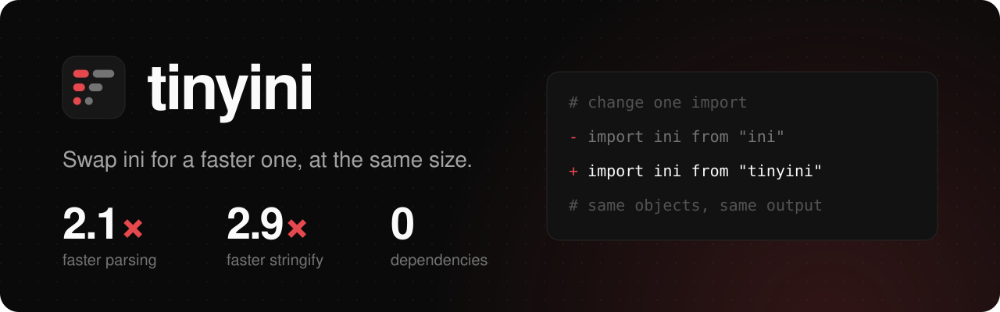

<h1>
  
</h1>

<!-- automd:comark-badges name=tinyini -->

[](https://github.com/onmax/tiny/releases)
[](./LICENSE)
[](https://github.com/onmax/tiny/actions/workflows/release.yaml)

<!-- /automd -->

**INI for JavaScript, 2 to 3 times faster than ini.** No dependencies, reads and writes INI the way [ini](https://github.com/npm/ini) 7.0.0 does, and passes all 40 of ini's own test assertions. It is not smaller: ini is already 1.6 KiB gzipped, and so is tinyini.

Already on ini? Change one import and keep your code:

```diff
- import ini from "ini";
+ import ini from "tinyini";
```

<!-- automd:drop-ins package=tinyini -->

| You use   | Switch to |    Size, gzip |      Parses | Stringifies |
| --------- | --------- | ------------: | ----------: | ----------: |
| ini 7.0.0 | `tinyini` | 1.6 → 1.6 KiB | 2.0× faster | 2.9× faster |

Size is the minified bundle, gzipped. Speed is the median time to parse and stringify the large benchmark file. Measured on Apple M4, Node 26.13.

<!-- /automd -->

I wrote it as a drop-in for ini 7.0.0, the version [confbox](https://github.com/unjs/confbox) 0.3.2 bundles.

[Get started](#get-started) · [Coming from ini](#coming-from-ini) · [Compatibility](#compatibility-with-ini-700) · [Size and speed](#size-and-speed)

An independent project by [@onmax](https://github.com/onmax).

## Get started

```sh
pnpm add tinyini
```

```ts
import ini, { parse, stringify } from "tinyini";

parse("; comment\nname = app\ntags[] = a\ntags[] = b\n[server.http]\nport = 8080\n");
// { name: "app", tags: ["a", "b"], server: { http: { port: "8080" } } }
stringify({ name: "app", server: { port: 8080 } }, { whitespace: true });
// "name = app\n\n[server]\nport = 8080\n"
ini.decode("a = true"); // { a: true }
```

`parse(text, options?)`, also exported as `decode`, returns an object with a null prototype, as do its sections. Values are strings, except `true`, `false`, and `null`, a key with no `=` (which is `true`), and `key[]` lines, which collect into an array. A value in double quotes is read as a JSON string, or kept as written if it is not one. A value in single quotes is read as JSON without its quotes, so `'1'` is the number 1 and `'x'` is the string `x`. `;` and `#` start a comment, unless a backslash escapes them. Dots split a section name into nested sections, unless a backslash escapes them. `__proto__` keys and sections are dropped.

| Option           | Default | What it does                                                                     |
| ---------------- | ------- | -------------------------------------------------------------------------------- |
| `bracketedArray` | `true`  | Read `key[]` lines as arrays. With `false`, a key that repeats becomes an array. |

`stringify(value, options?)`, also exported as `encode`, writes the top-level values first and then each nested object as a section. The second argument can also be a string, the `section`.

| Option           | Default            | What it does                                                                 |
| ---------------- | ------------------ | ---------------------------------------------------------------------------- |
| `section`        | none               | A section to put the top-level values in, and to prefix the rest by.         |
| `whitespace`     | `false`            | Write `=` instead of `=`.                                                    |
| `align`          | `false`            | Pad the keys of each section so the `=` signs line up. Implies `whitespace`. |
| `sort`           | `false`            | Sort the keys and sections on each level.                                    |
| `newline`        | `false`            | Put a blank line after each section header.                                  |
| `platform`       | `process.platform` | `"win32"` writes CRLF line endings, anything else LF.                        |
| `bracketedArray` | `true`             | Write array items as `key[]=value`, or with `false` as `key=value`.          |

As in ini, both functions write the normalized options back onto the object you pass, and `safe(value)` and `unsafe(value)` escape and unescape a single key or value.

### Coming from ini

```ts
// ini
import ini from "ini";
// or, as confbox does
import { parse, stringify } from "ini";

// tinyini
import ini, { parse, stringify } from "tinyini";
```

The calls, options, output, and errors are the same. tinyini has no CommonJS build.

## Compatibility with ini 7.0.0

I tested tinyini against ini 7.0.0 four ways:

- ini's own tests and tap snapshots, copied unchanged into `test/ini` and run with tinyini in place of ini, with the snapshots formatted by tcompare as tap 16 does. All 40 assertions pass, in all 5 files. The same harness passes 40 of 40 with ini itself.
- 1,000,000 inputs made by editing ini's fixtures and test strings, the config files in `test/samples` (two `.gitconfig` files, `.npmrc`, `.editorconfig`, `php.ini`, a systemd unit, `desktop.ini`, `setup.cfg`, `my.cnf`, and some odd cases, each also with CRLF endings, with a BOM, and as pkg-types' `parseGitConfig` rewrites them), and documents ini writes for random values. 970,041 of them are distinct. Each is parsed with `bracketedArray` unset, `true`, and `false`, and every tenth also with 10 odd options such as `null`, a string, a number, and frozen objects; `safe` and `unsafe` run on each too. That is 6,002,422 calls with 0 differences. The comparison covers prototypes, own key order, property flags, and shared references, the options object afterwards, and the error class and message for the 106,949 calls that throw (100,040 of them the `null` options). A second run of 200,000 with another seed, 198,308 of them distinct, also has 0 differences. The random numbers come from mulberry32.
- 10,000 random values, with nested and null-prototype objects, awkward keys and strings, dots, escapes, `__proto__` keys, arrays with holes, `undefined`, functions, symbols, BigInts, dates, `toJSON`, and cycles. Each is stringified with all 384 combinations of `align`, `sort`, `whitespace`, `newline`, `bracketedArray`, 3 platforms, and 4 sections, plus 12 odd options on every tenth value: 3,847,260 calls with byte-identical output and the same options object afterwards. Where ini throws, in 252,313 of them, tinyini throws the same error.
- The same values round-trip: `parse(stringify(x))` with tinyini gives what it gives with ini in all 3,590,262 checks.

Where tinyini differs:

- Strict mode. ini is CommonJS in sloppy mode, where a write to a primitive or a frozen object does nothing. tinyini is an ES module, so it checks for those cases and does nothing too: `parse("a=1\n[a]\nb=2")` returns `{ a: "1" }` in both. The copy of ini that confbox 0.3.2 bundles is an ES module and throws `Cannot create property 'b' on string '1'` there, so in confbox, tinyini returns ini's result where today it throws.
- Getters and proxies. ini reads `options.bracketedArray` again for every key line, where tinyini reads it once, and with `align` ini reads each value up to five times, where tinyini reads it twice. Only a getter or a proxy can tell.
- Arguments that are neither strings nor `String` objects but have their own `split` or `trim` method, passed to `parse` or `unsafe`, can give a different result.
- Stack depth. Both write nested objects recursively and run out of stack at different depths: here tinyini writes 5,469 nested objects to ini's 4,687.
- Packaging. ESM only, with named exports next to the default. The types are the signatures of `@types/ini` 4.1.1, plus exported `DecodeOptions` and `EncodeOptions`.

## Size and speed

Bundled with esbuild, minified ESM, then gzip level 9:

|                                                       | Minified | Gzip    |
| ----------------------------------------------------- | -------- | ------- |
| tinyini, the whole module                             | 3.55 KB  | 1.63 KB |
| tinyini, `parse` and `stringify`                      | 3.46 KB  | 1.58 KB |
| tinyini, `parse` only                                 | 2.08 KB  | 1.03 KB |
| ini, the whole module                                 | 3.46 KB  | 1.64 KB |
| ini, `parse` and `stringify`, as confbox imports them | 3.51 KB  | 1.66 KB |

ini is one CommonJS module, so a bundler keeps all of it and adds its CommonJS wrapper; its source alone minifies to 2.9 KB, 1.4 KB gzipped. tinyini's character loops take more code than ini's regular expressions, so the whole module is 0.1 KB larger minified. `parse` alone tree-shakes to 1.0 KB.

Median time per call on an Apple M4 with Node 26.13. `foo.ini` is ini's test fixture, `.gitconfig` is the one in `test/samples`, and the large file is 100 KB of generated sections with comments, quoted values, escapes, and arrays. Stringify uses `whitespace: true`, as confbox does.

| Operation               | ini           | tinyini      | Speedup |
| ----------------------- | ------------- | ------------ | ------- |
| Parse `foo.ini`         | 22.3 &micro;s | 8.4 &micro;s | 2.7x    |
| Parse `.gitconfig`      | 19.2 &micro;s | 7.2 &micro;s | 2.7x    |
| Parse a 100 KB file     | 1.41 ms       | 0.70 ms      | 2.0x    |
| Stringify `foo.ini`     | 10.3 &micro;s | 4.0 &micro;s | 2.6x    |
| Stringify `.gitconfig`  | 15.5 &micro;s | 7.5 &micro;s | 2.1x    |
| Stringify a 100 KB file | 1.27 ms       | 0.44 ms      | 2.9x    |

ini matches each line against three regular expressions and walks every value a character at a time to find comments. tinyini looks at character codes once per line, builds a value character by character only when it has a backslash, and only calls `JSON.parse` on a single-quoted value that could be JSON, since a throw costs more than the parse. On the large file, about a third of tinyini's time goes to splitting the lines and building the null-prototype objects, which both do.

## Develop

tinyini uses pnpm 12, Node 26, and [Vite+](https://viteplus.dev) (`vp`) for formatting, linting, tests, and the build. [tsrs](https://github.com/oxc-project/tsrs) does the typecheck.

```sh
pnpm install
pnpm ready                   # format, build, lint, typecheck, and test
pnpm ini-tests               # ini's own tests against ini and tinyini
pnpm fuzz 1000000 1          # 1,000,000 mutated inputs with seed 1
pnpm fuzz:stringify 10000 1  # 10,000 random values through every option
pnpm size                    # bundle sizes next to ini
pnpm bench                   # speed next to ini
```

## License

[MIT](./LICENSE). The tests in `test/ini` are ini's, under its [ISC license](./test/ini/LICENSE).
