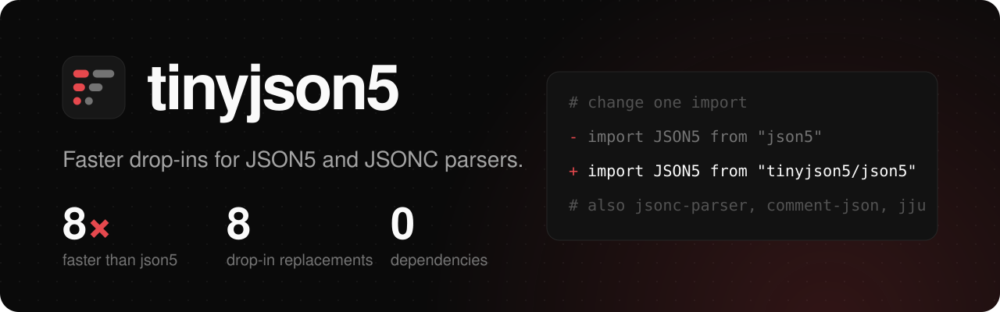

<h1>
  
</h1>

<!-- automd:comark-badges name=tinyjson5 size=size -->

[](https://github.com/onmax/tiny/releases)
[](#size)
[](https://www.npmjs.com/package/tinyjson5?activeTab=dependencies)
[](./LICENSE)
[](https://github.com/onmax/tiny/actions/workflows/release.yaml)

<!-- /automd -->

**JSON5 for JavaScript in 3.4 KiB.** No dependencies, json5 3's rules before json5 3 is out, and strict JSON with comments with one option.

Already on a JSON5 or JSONC library? Change one import and keep your code:

```diff
- import JSON5 from "json5";
+ import JSON5 from "tinyjson5/json5";
```

tinyjson5 ships drop-in replacements for json5 2 and 1, strip-json-comments 3, 2 and 5, jsonc-parser, comment-json and jju. Each one is smaller and faster than the library it replaces, passes the library's own tests that the library itself passes, and gives the same result on a million fuzzed inputs.

<!-- automd:drop-ins package=tinyjson5 -->

| You use               | Switch to                          |      Size, gzip |      Parses | Stringifies |
| --------------------- | ---------------------------------- | --------------: | ----------: | ----------: |
| json5 2.2.3           | `tinyjson5/json5`                  |   7.6 → 3.2 KiB | 8.1× faster | 5.6× faster |
| json5 1.0.2           | `tinyjson5/json5-v1`               |   8.4 → 3.3 KiB | 8.4× faster | 6.1× faster |
| strip-json-comments 3 | `tinyjson5/strip-json-comments`    |   0.8 → 0.5 KiB | 3.9× faster |           — |
| strip-json-comments 2 | `tinyjson5/strip-json-comments-v2` |   0.7 → 0.5 KiB | 4.1× faster |           — |
| strip-json-comments 5 | `tinyjson5/strip-json-comments-v5` |   0.6 → 0.6 KiB | 3.9× faster |           — |
| jsonc-parser 3.3.1    | `tinyjson5/jsonc-parser`           |   6.6 → 5.7 KiB | 1.2× faster |           — |
| comment-json 4.6.2    | `tinyjson5/comment-json`           | 35.7 → 18.4 KiB | 1.6× faster | 1.7× faster |
| jju 1.4.0             | `tinyjson5/jju`                    |   9.8 → 9.7 KiB | 1.2× faster | 1.6× faster |

The root `tinyjson5` API is 3.4 KiB against 7.6 KiB for json5 2.2.3. It parses 8.3× faster than json5 2.2.3 and stringifies 5.1× faster.

Size is the minified bundle, gzipped. Speed is the median time to parse and stringify the large benchmark file. Measured on AMD Ryzen 7 255 w/ Radeon 780M Graphics, Node 24.21.0.

<!-- /automd -->

For strip-json-comments, which only strips the comments, "Parses" is the time to strip them.

[Get started](#get-started) · [Switching](#switching-from-another-library) · [Size](#size) · [Speed](#speed) · [API](#api) · [Develop](#develop)

An independent project by [@onmax](https://github.com/onmax).

## Get started

```sh
pnpm add tinyjson5
```

npm holds only a 0.0.0 placeholder under this name until the first release. Until then, clone this repository and run `pnpm install` and `pnpm build` to get the package in `dist/`.

```ts
import JSON5, { parse, stringify } from "tinyjson5";

parse("{name: 'app', tags: ['a', 'b',], /* comment */ size: 0x10}");
// { name: "app", tags: ["a", "b"], size: 16 }
parse('// tsconfig\n{"strict": true}', { jsonc: true }); // { strict: true }
parse("9007199254740993", { bigint: true }); // 9007199254740993n
stringify({ name: "app", "a-b": [1, NaN] }); // "{name:'app','a-b':[1,NaN]}"
stringify({ a: 1 }, null, 2); // "{\n  a: 1,\n}"
JSON5.parse("[1, 2]"); // [1, 2]
```

The root follows [json5](https://github.com/json5/json5)'s main branch, which holds json5 3 before its release, and adds a strict JSONC mode. Where json5 2 and JSON differ, it does what `JSON.parse` and `JSON.stringify` do:

- No `console.warn`. json5 2 warns about U+2028 and U+2029 in strings.
- The reviver walks own keys, as `JSON.parse`'s does, and a property it can't update stays as it is instead of throwing.
- Error positions count `\r`, `\r\n`, U+2028 and U+2029 as line breaks, and an error on a line break is reported on the line it ends.
- `{ bigint: true }` returns integers outside the safe range, decimal or hex, as BigInts. A number with a decimal point or an exponent stays a Number.
- `stringify` throws on a BigInt, takes only `'` or `"` as `quote`, escapes lone surrogates, writes keys with identifier characters above U+FFFF bare, and reads replacer lists, arrays and `toJSON5`/`toJSON` once, as `JSON.stringify` does.

`{ jsonc: true }` accepts JSON with `//` and `/* */` comments and nothing more: no single quotes, unquoted keys, hex, `+`, `Infinity`, `NaN`, trailing commas, escapes JSON lacks, or whitespace other than JSON's. Line comments end at `\n` or `\r`, and block comments at `*/`.

Invalid input throws a `SyntaxError` with json5's message and its `lineNumber` and `columnNumber`, as in `JSON5: invalid character '@' at 2:5`.

## Switching from another library

Each subpath exports the functions, options and types of the library it replaces, apart from the gaps listed below, so switching is a change to the import line. The last column is that library's own test suite, copied unchanged into `test/` and run with tinyjson5 in its place.

| Library                   | Change the import to                 | Size, gzip      | Its own tests on tinyjson5 |
| ------------------------- | ------------------------------------ | --------------- | -------------------------- |
| json5 2.2.3               | `"tinyjson5/json5"`                  | 7.6 → 3.2 KiB   | 160 of 160                 |
| json5 1.0.2               | `"tinyjson5/json5-v1"`               | 8.4 → 3.3 KiB   | 144 of 144                 |
| strip-json-comments 3.1.1 | `"tinyjson5/strip-json-comments"`    | 0.8 → 0.5 KiB   | 10 of 10                   |
| strip-json-comments 2.0.1 | `"tinyjson5/strip-json-comments-v2"` | 0.7 → 0.5 KiB   | 9 of 9                     |
| strip-json-comments 5.0.3 | `"tinyjson5/strip-json-comments-v5"` | 654 → 646 B     | 13 of 13                   |
| jsonc-parser 3.3.1        | `"tinyjson5/jsonc-parser"`           | 6.6 → 5.7 KiB   | 83 of 83                   |
| comment-json 4.6.2        | `"tinyjson5/comment-json"`           | 35.7 → 18.4 KiB | 384 of 384                 |
| jju 1.4.0                 | `"tinyjson5/jju"`                    | 9.8 → 9.7 KiB   | 421 of 423                 |

jju fails the same 2 of its own tests itself under today's Node: they compare it with `eval`. json5 2.2.3's tests include json5's errors tests, and tinyjson5's root runs json5's main-branch tests too: 197 of 198 pass, and the one left needs an identifier character from Unicode 18, which Node 24 doesn't know yet.

```ts
// before
import { parse, modify, applyEdits } from "jsonc-parser";
// after
import { parse, modify, applyEdits } from "tinyjson5/jsonc-parser";
```

Every subpath is checked a second way, with differential fuzzing: inputs made by editing the json5-tests corpus, each library's own test inputs and generated documents at random, and run through both with every option the subpath takes. The details below give the counts and list each known difference.

All subpaths are ES modules. None has a CommonJS build, a CLI, or a `require` hook for `.json5` files.

<details>
<summary>json5 2.2.3 and 1.0.2: what's different</summary>

- Identifier characters come from the JavaScript engine's own Unicode tables (`\p{ID_Start}`, `\p{ID_Continue}`), not the ones json5 ships (Unicode 10 in 2.2.3, older in 1.0.2). On Node 24 (Unicode 17) that adds 20,588 characters that can start an unquoted key and 21,146 that can continue one, against json5 2.2.3's tables, such as U+0560. No character json5 accepts is rejected; U+2E2F, which json5's tables count as a letter, is special-cased to keep it that way. `pnpm unicode` prints the full list.
- json5 1.0.2 reads the end of input as the string `"undefined"`, whose `d`, `e` and `f` are hex digits. A hex number that ends the input makes it append `"undefined"` until the string is too long, which takes seconds and hundreds of megabytes. tinyjson5/json5-v1 throws the same `RangeError: Invalid string length` at once.
- json5 1.0.2 is compiled by Babel, and its `for...of` loops go through iterators. A replacer list is iterated as Babel does, but strings and key lists are not, so a patched `String.prototype[Symbol.iterator]`, or an `Array.prototype[Symbol.iterator]` whose `next` or `return` changes, is used differently.
- A `parse` called from inside `console.warn` while json5 warns about U+2028 returns the inner result in json5, whose shared state it overwrites. tinyjson5 throws an end-of-input error there.
- Stack depth: `stringify` and the reviver recurse in both, and run out of stack at slightly different depths.
- 1,000,500 inputs each (500 seeds and a million edits of them) give the same value or the same error, message and position, as json5 2.2.3 (739,687 errors) and json5 1.0.2 (757,833 errors, 4,543 of them that `RangeError`), and the same warnings. 14,000 random values through every space, quote and replacer, 1,037,400 `stringify` calls each, are byte-identical, and every round trip reads back.

</details>

<details>
<summary>strip-json-comments 3, 2 and 5: what's different</summary>

- tinyjson5/strip-json-comments-v2 with an argument that isn't a string, null or undefined: strip-json-comments 2 runs its loop on the object itself, through `length`, its indexes, `slice` and `substr`. The subpath reads `length`, throws `TypeError: str.substr is not a function` if there's no `substr`, and else strips `String(argument)`. Doing what 2 does would make the subpath bigger than it.
- 1,000,400 inputs each (400 seeds and a million edits of them), with every option set: 3,001,221 calls to 3, 4,001,628 to 2 and 5,002,035 to 5, with the same output or the same error.

</details>

<details>
<summary>jsonc-parser: what's different</summary>

- Its enums are declared as `declare enum`, not `declare const enum`: code reads `SyntaxKind.StringLiteral` from the exported object instead of inlining 10, which also works under `isolatedModules` and `verbatimModuleSyntax`.
- `visit` passes one path-supplier function to all of a visit's callbacks, where jsonc-parser makes a new one for each. Each returns the path at the time it's called, as there.
- Token values are cut from the text with `substring`, when asked for, where jsonc-parser builds trivia with `String.fromCharCode` and cuts the rest as it scans. A program that replaces `String.prototype.substring` or `String.fromCharCode`, also between a `scan()` and its `getTokenValue()`, sees other calls and values; `String.prototype.charCodeAt` is called as jsonc-parser calls it.
- No deep imports such as `jsonc-parser/lib/esm/impl/format`. Its `string-intern` test, which tests caches inside its formatter, isn't run.
- 1,000,922 inputs (922 seeds and a million edits of them), 23,021,226 calls over the whole API: the scanner in both trivia modes and after `setPosition`, `parse` and `parseTree` with each option set, `visit` with suppressed callbacks, `getLocation`, `findNodeAtOffset`, `findNodeAtLocation`, `getNodePath`, `getNodeValue`, `stripComments`, `format` with random ranges and options and `modify` with random paths, values and options, both through `applyEdits`. All give the same result or throw the same error.

</details>

<details>
<summary>comment-json: what's different</summary>

- `stringify` reads each object's comments once per call. Code that runs while the value is written and adds or changes comments, such as a getter, a `toJSON`, or the `toString` of a comment's value, isn't seen, where comment-json reads them again. An object with a getter for a comment is read as comment-json reads it, and a proxy sees other traps. Without a replacer only, and only with `Symbol.for` and the prototypes of objects, arrays and `CommentArray` as they were; otherwise comments are read as comment-json reads them.
- `tokenize` builds esprima's tokens itself for JSON with comments, and hands any other input to esprima's own tokenizer, which comes along unchanged.
- Both faster paths, the comment read and the tokenizer, run only while the built-ins they rely on are the engine's own, and otherwise do what comment-json and esprima do. They tell from each built-in's name and source, read from its descriptor without running a getter, and from what it does on a known input. A program that replaces `globalThis`, `Object`, `Function`, `Reflect`, `Object.getOwnPropertyDescriptor`, `Reflect.apply` or `Function.prototype.toString` before tinyjson5 loads can fool that check, which has to read and call them before it can check anything.
- No `require("comment-json")`: ES modules only, and no deep imports.
- 1,000,509 inputs (509 seeds and a million edits of them), 8,004,072 calls: `parse` with and without comments and with a reviver, compared with every comment symbol and token; `tokenize`; `stringify` with each space and replacer; `assign`, `moveComments` and `removeComments`. All give the same result or throw the same error, with esprima's and comment-json's error fields.

</details>

<details>
<summary>jju: what's different</summary>

- Not jju's `utils`: its `require` hook for `.json5` files, its `JSON.parse` patch and its middleware, which are Node-only.
- Off Node, an assertion `update` trips throws an `AssertionError`-named error with Node's code and fields but a shorter message. On Node it's Node's own `AssertionError`, as in jju.
- 1,000,648 inputs (648 seeds and a million edits of them), 6,003,888 calls: `parse` in each mode with random options, `tokenize`, `analyze`, `stringify` with random options, and `update`, with the same result or the same error, `row` and `column` included.

</details>

jju, comment-json and array-timsort are written for sloppy mode, and their ports run as ES modules, which are strict. Writes that would fail silently there go through `Reflect.set` and `Reflect.deleteProperty` here, so frozen options, objects and arrays behave the same. jju's go through one sloppy-mode function made with `Function` instead, which is faster, and through `Reflect` where a Content-Security-Policy or `--disallow-code-generation-from-strings` blocks it.

## Size

Bundled with esbuild, minified ESM, every export kept, then gzip -9 (`pnpm size`):

| Entry                              | Minified |     Gzip | Original                  |  Minified |     Gzip |
| ---------------------------------- | -------: | -------: | ------------------------- | --------: | -------: |
| `tinyjson5`                        |  8.5 KiB |  3.4 KiB | json5 2.2.3               |  26.5 KiB |  7.6 KiB |
| `tinyjson5/json5`                  |  7.8 KiB |  3.2 KiB | json5 2.2.3               |  26.5 KiB |  7.6 KiB |
| `tinyjson5/json5-v1`               |  8.0 KiB |  3.3 KiB | json5 1.0.2               |  29.2 KiB |  8.4 KiB |
| `tinyjson5/strip-json-comments`    |  0.9 KiB |  0.5 KiB | strip-json-comments 3.1.1 |   1.3 KiB |  0.8 KiB |
| `tinyjson5/strip-json-comments-v2` |  0.9 KiB |  0.5 KiB | strip-json-comments 2.0.1 |   1.2 KiB |  0.7 KiB |
| `tinyjson5/strip-json-comments-v5` |  1.1 KiB |  0.6 KiB | strip-json-comments 5.0.3 |   1.1 KiB |  0.6 KiB |
| `tinyjson5/jsonc-parser`           | 16.7 KiB |  5.7 KiB | jsonc-parser 3.3.1        |  19.7 KiB |  6.6 KiB |
| `tinyjson5/comment-json`           | 59.8 KiB | 18.4 KiB | comment-json 4.6.2        | 151.8 KiB | 35.7 KiB |
| `tinyjson5/jju`                    | 28.0 KiB |  9.7 KiB | jju 1.4.0                 |  28.4 KiB |  9.8 KiB |

jju needs Node's `fs` and `assert`, so it's measured for Node, without them. Each entry is built on its own, so it carries no code of another; the root carries json5 3's additions and the `jsonc` mode, which put it above `tinyjson5/json5`.

## Speed

Every entry is faster than its original at every operation benchmarked, from 1.04× (jsonc-parser's `format` of the tsconfig) to 11.4×. `pnpm bench` times each entry against its original, on the built `dist/`, with a 14-line tsconfig, json5's own `test.json5`, and json5 2.2.3's package-lock.json as 220 KB of JSON5 and 229 KB of JSON with comments. Each time is the median of 7 runs, measured on AMD Ryzen 7 255 w/ Radeon 780M Graphics, Node 24.21.0:

<details>
<summary>Every operation</summary>

| Original                      | Operation            | Original | tinyjson5 | Speedup |
| ----------------------------- | -------------------- | -------: | --------: | ------: |
| json5 2.2.3                   | parse tsconfig       |  27.9 µs |    3.2 µs |   8.86× |
| json5 2.2.3                   | stringify tsconfig   |   5.0 µs |    1.5 µs |   3.28× |
| json5 2.2.3                   | parse test.json5     |   2.4 µs |    297 ns |   8.13× |
| json5 2.2.3                   | stringify test.json5 |   297 ns |    194 ns |   1.53× |
| json5 2.2.3                   | parse large          | 16.23 ms |   2.01 ms |   8.06× |
| json5 2.2.3                   | stringify large      |  5.17 ms |  925.3 µs |   5.59× |
| json5 1.0.2                   | parse tsconfig       |  37.8 µs |    3.3 µs |  11.39× |
| json5 1.0.2                   | stringify tsconfig   |   5.2 µs |    1.4 µs |   3.72× |
| json5 1.0.2                   | parse test.json5     |   2.4 µs |    264 ns |   9.20× |
| json5 1.0.2                   | stringify test.json5 |   299 ns |    211 ns |   1.42× |
| json5 1.0.2                   | parse large          | 16.28 ms |   1.93 ms |   8.42× |
| json5 1.0.2                   | stringify large      |  4.24 ms |  693.7 µs |   6.12× |
| strip-json-comments 3         | strip tsconfig       |   5.5 µs |    1.1 µs |   4.83× |
| strip-json-comments 3         | strip large          |  3.74 ms |  965.8 µs |   3.87× |
| strip-json-comments 2         | strip tsconfig       |   6.3 µs |    1.1 µs |   5.55× |
| strip-json-comments 2         | strip large          |  4.68 ms |   1.15 ms |   4.06× |
| strip-json-comments 5         | strip tsconfig       |   5.6 µs |    1.2 µs |   4.70× |
| strip-json-comments 5         | strip large          |  3.81 ms |  970.6 µs |   3.93× |
| jsonc-parser 3.3.1            | parse tsconfig       |   5.0 µs |    4.4 µs |   1.14× |
| jsonc-parser 3.3.1            | parseTree tsconfig   |   5.4 µs |    4.7 µs |   1.14× |
| jsonc-parser 3.3.1            | visit tsconfig       |   3.5 µs |    3.2 µs |   1.11× |
| jsonc-parser 3.3.1            | format tsconfig      |   3.3 µs |    3.1 µs |   1.04× |
| jsonc-parser 3.3.1            | parse large          |  2.14 ms |   1.84 ms |   1.17× |
| jsonc-parser 3.3.1            | parseTree large      |  2.06 ms |   1.69 ms |   1.22× |
| jsonc-parser 3.3.1            | visit large          |  1.63 ms |   1.40 ms |   1.17× |
| jsonc-parser 3.3.1            | format large         |  1.73 ms |   1.50 ms |   1.16× |
| comment-json 4.6.2            | parse tsconfig       |  18.2 µs |   14.2 µs |   1.28× |
| comment-json 4.6.2            | stringify tsconfig   |  13.1 µs |    9.3 µs |   1.40× |
| comment-json 4.6.2            | parse large          | 15.47 ms |   9.83 ms |   1.57× |
| comment-json 4.6.2            | stringify large      |  7.62 ms |   4.56 ms |   1.67× |
| jju 1.4.0                     | parse tsconfig       |   7.2 µs |    5.8 µs |   1.22× |
| jju 1.4.0                     | stringify tsconfig   |   6.5 µs |    4.1 µs |   1.61× |
| jju 1.4.0                     | parse test.json5     |   1.1 µs |    755 ns |   1.47× |
| jju 1.4.0                     | stringify test.json5 |   989 ns |    722 ns |   1.37× |
| jju 1.4.0                     | parse large          |  3.24 ms |   2.65 ms |   1.22× |
| jju 1.4.0                     | stringify large      |  3.19 ms |   1.99 ms |   1.61× |
| json5 2.2.3, against the root | parse tsconfig       |  26.8 µs |    3.1 µs |   8.72× |
| json5 2.2.3, against the root | stringify tsconfig   |   4.9 µs |    1.4 µs |   3.50× |
| json5 2.2.3, against the root | parse test.json5     |   2.4 µs |    251 ns |   9.40× |
| json5 2.2.3, against the root | stringify test.json5 |   286 ns |    205 ns |   1.39× |
| json5 2.2.3, against the root | parse large          | 14.36 ms |   1.73 ms |   8.30× |
| json5 2.2.3, against the root | stringify large      |  3.76 ms |  735.4 µs |   5.12× |

</details>

## API

### `parse(text, reviver?, options?)`

Parses JSON5 and returns the value. `parse(text, options)` works too. The reviver is the one `JSON.parse` takes.

| Option   | Default | What it does                                                                                                                                        |
| -------- | ------- | --------------------------------------------------------------------------------------------------------------------------------------------------- |
| `bigint` | `false` | Return integers outside the safe range, decimal or hex, as BigInts. A number with a decimal point or an exponent stays a Number. Must be a boolean. |
| `jsonc`  | `false` | Accept only JSON with comments.                                                                                                                     |

### `stringify(value, replacer?, space?)` and `stringify(value, options)`

Writes JSON5. The replacer is a function or a list of keys, and `space` works as in `JSON.stringify`, up to 10 characters.

| Option     | Default | What it does                                                                               |
| ---------- | ------- | ------------------------------------------------------------------------------------------ |
| `replacer` | none    | A function that changes each value, or a list of the keys to keep.                         |
| `space`    | none    | Spaces per level (at most 10) or a string (its first 10 characters). Adds trailing commas. |
| `quote`    | auto    | `'` or `"`. By default `'`, or `"` when the string has more `'` than `"`.                  |

Keys that are identifiers are written bare. `NaN`, `Infinity` and `-Infinity` are written as such, `-0` as `0`. `toJSON5()` is used before `toJSON()`. A cycle throws `TypeError: Converting circular structure to JSON5`.

## Develop

tinyjson5 uses pnpm 12, Node 24 or later, and [Vite+](https://viteplus.dev) (`vp`) for formatting, linting, tests and the build. [tsrs](https://github.com/oxc-project/tsrs) does the typecheck. Each entry is built on its own, with `src/core/mode/<mode>.ts` in place of `src/core/mode.ts`, so it carries no other entry's code; `pnpm size` fails if one does.

```sh
pnpm install
pnpm ready                       # format, build, lint, typecheck, and test
pnpm corpus:fetch                # json5-tests, into .cache
pnpm json5:fetch                 # json5 2.2.3, into .cache, for the large benchmark input
pnpm json5:main:fetch            # json5's main branch, into .cache, the root's reference
pnpm json5-tests                 # json5 2.2.3's own tests against tinyjson5/json5
pnpm own-tests <suite>           # an original's own tests: json5-main, json5-v1, strip-json-comments(-v2, -v5), jsonc-parser, comment-json, jju
pnpm corpus [engine]             # every json5-tests case
pnpm fuzz 200000 3 [engine]      # mutated inputs: json5, json5-v1, root, root-bigint, jsonc
pnpm fuzz:stringify 10000 1 [engine]
pnpm fuzz:strip 100000 1 v3      # strip-json-comments v2, v3 or v5
pnpm fuzz:jsonc 20000 1          # jsonc-parser's whole API
pnpm fuzz:comment-json 20000 1
pnpm fuzz:jju 20000 1
pnpm unicode                     # identifier characters that differ from json5's tables
pnpm size                        # bundle sizes next to each original
pnpm bench                       # speed next to each original
```

## License

[MIT](./LICENSE). The ported code and copied tests keep their licenses, collected for the package in [THIRD-PARTY-NOTICES.md](./THIRD-PARTY-NOTICES.md): json5's tests (MIT), jsonc-parser (MIT, Microsoft), comment-json (MIT), esprima's tokenizer (BSD-2-Clause, JS Foundation), array-timsort (MIT), jju (MIT, Alex Kocharin) and strip-json-comments' tests (MIT, Sindre Sorhus). Each copy has its license next to it.
